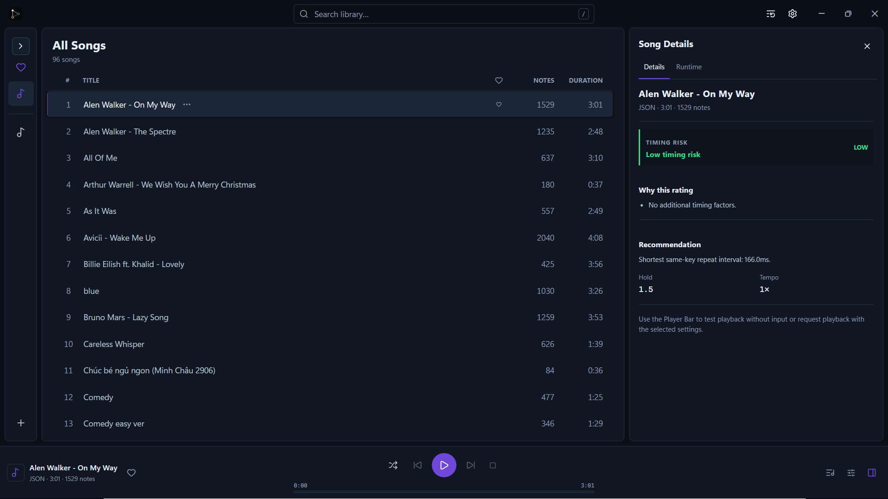

# Sky Auto Player

**Play the sheet. Not the keyboard.**

A free, open-source music-sheet player for **Sky: Children of the Light** on Windows, powered by Rust and Tauri.

**[Download for Windows](https://github.com/pumni/Sky-Auto-Player/releases/latest)** ·
[Website](https://pumni.github.io/Sky-Auto-Player/) ·
[FAQ](https://pumni.github.io/Sky-Auto-Player/faq/)

  

---

**Sky Auto Player** turns supported music sheets into timed keyboard input for Sky's 15-key instruments. Browse the included song library, organize playlists, or bring your own sheets—then let the native playback engine handle notes, chords, and holds while you enjoy the music.

Unlike a generic sequence of keyboard macros, the player follows the sheet's musical timing and applies frame-aware hold and release policies. Actual input timing still depends on Windows, the game, and your system.

## Highlights

- **Built-in music library** — Explore 100+ bundled songs, search by title, and save favorites.
- **Playlists and imports** — Create playlists, add built-in tracks, or import local sheet files and folders without moving the originals.
- **Music-aware playback** — Native Rust scheduling, grouped chord input, and configurable tempo, target FPS, hold frames, and timing margin.
- **Sheet compatibility tools** — Inspect supported sheet versions, select playable tracks or target pitch, and review conversion losses before playback.
- **Playback you can inspect** — Player Dock controls, dry-run testing (no keyboard input), timing diagnostics, and focus-aware safeguards.
- **Modern desktop experience** — Tauri 2 + React interface with System / Light / Dark appearance, color palettes, and in-app update support.

## Quick Start

**Requirements:** Windows 11 (64-bit). The desktop installer is intended for the current Windows user and normally needs no administrator privileges. No Python installation or separate scripting runtime is required.

1. **Download** the Windows `.exe` installer from [Latest Release](https://github.com/pumni/Sky-Auto-Player/releases/latest).
2. **Install and launch** Sky Auto Player, then select a song under **Built-in Songs**.
3. **Open Sky**, equip a compatible 15-key instrument, and return focus to the game when starting playback.

Want to check a playback profile first? Choose **Playback profile → Test playback (no input)** to run a dry-run preview without sending keystrokes.

### Bring Your Own Sheets

1. Create or open a **playlist** in the Library.
2. Choose **Add songs → Import files…** or **Import folder…**. You can also select **Browse Built-in Songs…** to add bundled tracks.
3. Select compatible `.json`, `.skysheet`, or JSON-compatible `.txt` files. Successfully imported songs appear in the playlist without a manual reload.

Imports reference files where they already live; they **do not copy, move, or delete** your originals. If you need to create a sheet, try the separate [Sky Music Nightly editor](https://specy.github.io/skyMusic/).

## Why the Native Engine Matters

Sky Auto Player is built around a Rust real-time playback engine (`sky_player`), not a browser timer or a separate scripting process.

- **Consistent musical targets:** The runtime preserves authored schedule offsets and uses Windows high-resolution timers with QueryPerformanceCounter (QPC) scheduling.
- **Chords dispatched together:** Notes belonging to the same chord are grouped into a single Windows `SendInput` batch to reduce sender-side skew.
- **Frame-aware holds:** Minimum key-hold and release-gap policies account for the selected game FPS and timing margin.
- **Focus-aware handling:** When the target game loses focus, new key-down events are blocked and playback timing is paused; recovery and key-release cleanup remain conservative.

The engine uses MMCSS scheduling when available and records diagnostics for analysis. These mechanisms improve control over *sender-side* timing; they are **not a guarantee of sub-millisecond in-game or audible accuracy**.

For implementation details and measurement limitations, see [Playback Engine](docs/playback-engine.md) and [Playback Verification](docs/playback-verification.md).

## Safety, Compatibility & Updates

**Windows input only.** Sky Auto Player sends simulated key presses through the public Windows `SendInput` API. It does **not** read or write game memory, inject DLLs, install input hooks, attach debuggers, bypass anti-cheat, or alter game files.

> [!WARNING]
> Automated playback may conflict with **Sky: Children of the Light** Terms of Service. Using ordinary keyboard input does not guarantee account safety. Use the application responsibly and at your own risk. This is an unofficial community project, not affiliated with or endorsed by thatgamecompany.

**Updates:** The app can notify you about updates and offer **Update and Restart**. The official Tauri updater verifies the downloaded update artifact's cryptographic signature before installation.

> [!NOTE]
> Current Windows installers are intentionally **not Authenticode-signed**; Windows may display **Unknown Publisher** or a SmartScreen warning. The updater's cryptographic signature does **not** provide an Authenticode publisher identity. Only download installers from the [official GitHub Releases](https://github.com/pumni/Sky-Auto-Player/releases).

See the [Security Policy](SECURITY.md) and [Distribution & Update](docs/distribution-and-update.md) documentation for the full security model.

## FAQ

<strong>Will it run on macOS or Linux?</strong>

No. The supported desktop application depends on Windows-specific timing and input APIs.

<strong>What kinds of music sheets work?</strong>

The app accepts supported JSON-based Sky sheets in `.json`, `.skysheet`, and JSON-compatible `.txt` files. Not every historical or versioned sheet can be played losslessly: Song Details shows compatibility information and may ask you to review conversion losses.

<strong>Can I build it from source?</strong>

Yes. The project uses Rust and Bun for development and verification. See [Contributing](CONTRIBUTING.md), the [Documentation Index](docs/INDEX.md), and [Tauri Packaging](docs/v4-tauri-packaging.md) for the maintained developer workflow.

More answers are available in the [full FAQ](https://pumni.github.io/Sky-Auto-Player/faq/).

## Support the Project

If Sky Auto Player makes your Sky music experience better, consider [starring the repository](https://github.com/pumni/Sky-Auto-Player/stargazers). For bug reports, ideas, or feedback, open a [GitHub Issue](https://github.com/pumni/Sky-Auto-Player/issues). Contributions are welcome; see [CONTRIBUTING.md](CONTRIBUTING.md).

If you would like to support continued development:

  

## License

[GNU General Public License v3.0](LICENSE) · © [pumni](https://github.com/pumni)
