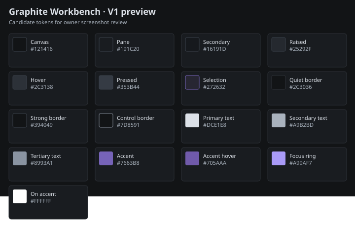

# Graphite Workbench: V1 visual approval

## Decision requested

Please approve these Graphite preview screenshots as the visual basis for V2, or request changes to the palette, Search placement, text hierarchy, or emphasis. This approves the visual direction for the next package; it does not add Graphite to saved settings or change the default palette.

## Matched Playwright captures

The screenshots are real browser captures of the desktop app using its deterministic mock bridge. Both variants use the same 500-track library and state: Update is available, Search is focused, Candle Run is playing in dry-run mode, and Blue Bird is selected for inspection. The 640 px Inspector is a compact overlay; the wider captures use the docked Inspector. Each Runtime image shows the dry-run no-input status.

Baseline source: `36422ad2ea524269cc524b9642a65655290e9284`. Preview implementation source: `846a17f35926ba22a62909b973cc4c8a5724a3c9`. Screenshots use logical CSS viewports at 100% browser scale; titlebar geometry tests also cover simulated device scale factors of 100%, 125%, and 150%.

| CSS viewport | Before: workbench                     | Graphite: workbench                     | Before: Runtime                     | Graphite: Runtime                     |
| ------------ | ------------------------------------- | --------------------------------------- | ----------------------------------- | ------------------------------------- |
| 640×448      | [PNG](before/workbench-640x448.png)   | [PNG](graphite/workbench-640x448.png)   | [PNG](before/runtime-640x448.png)   | [PNG](graphite/runtime-640x448.png)   |
| 800×560      | [PNG](before/workbench-800x560.png)   | [PNG](graphite/workbench-800x560.png)   | [PNG](before/runtime-800x560.png)   | [PNG](graphite/runtime-800x560.png)   |
| 1366×768     | [PNG](before/workbench-1366x768.png)  | [PNG](graphite/workbench-1366x768.png)  | [PNG](before/runtime-1366x768.png)  | [PNG](graphite/runtime-1366x768.png)  |
| 1920×1080    | [PNG](before/workbench-1920x1080.png) | [PNG](graphite/workbench-1920x1080.png) | [PNG](before/runtime-1920x1080.png) | [PNG](graphite/runtime-1920x1080.png) |

The 640 px titlebar close-up shows the original Search/Update collision and its repair. The 800 px and wider close-ups show the centered Search track.

| Viewport         | Before                             | Graphite                             |
| ---------------- | ---------------------------------- | ------------------------------------ |
| 640×48 titlebar  | [PNG](before/titlebar-640x48.png)  | [PNG](graphite/titlebar-640x48.png)  |
| 800×48 titlebar  | [PNG](before/titlebar-800x48.png)  | [PNG](graphite/titlebar-800x48.png)  |
| 1366×48 titlebar | [PNG](before/titlebar-1366x48.png) | [PNG](graphite/titlebar-1366x48.png) |
| 1920×48 titlebar | [PNG](before/titlebar-1920x48.png) | [PNG](graphite/titlebar-1920x48.png) |

## Palette and hierarchy



The preview uses the candidate semantic tokens from #499. Measured contrast includes 13.01:1 for primary text on the pane, 7.97:1 for secondary text on the pane, 4.70:1 for tertiary text on raised controls, 4.59:1 for the interactive control border on the pane, 3.01:1 for the accent on selection, and 7.04:1 for the focus ring on the pane. The browser test checks body text at 4.5:1 minimum and UI boundaries, selection, and focus at 3:1 minimum. Existing success, warning, and danger tokens are unchanged.

| Role                                        | Graphite size | Use                                |
| ------------------------------------------- | ------------: | ---------------------------------- |
| Page heading                                |         20 px | Main view identity                 |
| Section heading                             |         16 px | Pane and section titles            |
| Body and control label                      |         14 px | Song content and controls          |
| Metadata                                    |         12 px | Supporting text and eyebrow labels |
| Critical Player Dock mode and identity cues | 11 px minimum | Now Playing and Dry run labels     |

Accent is limited to focus, active tabs, selection edges, and the existing primary playback control. Selected and playing rows remain distinct through their selection surface and playback icon. The Player Dock retains the explicit Dry run label, while Runtime states that no physical input was sent and sender metrics were not measured.

## Known visual compromises

- V1 changes the titlebar and foundational tokens only. The current panes, browser rows, and Inspector still use their existing component structure and some nested borders; broader workbench polish is reserved for V2.
- At widths up to 700 px, Search sits between the brand and the right control rail so it can stay useful without collisions. At 800 px and wider it remains centered. Long playlist labels keep their full accessible name and clip within the input.
- The preview is Chromium with the mock bridge, not a packaged Tauri window. Drag-region attributes and real hit targets are covered in browser tests; an OS-level window drag was not simulated. DPI coverage is simulated in Playwright, not captured from physical Windows scaling.

## Evidence commands

Preview screenshots were captured with:

```powershell
$env:VISUAL_EVIDENCE_VARIANT='graphite'; bun run test:e2e visual-evidence.spec.ts
```

Baseline screenshots were captured from a temporary worktree at the baseline SHA with the same test and `VISUAL_EVIDENCE_VARIANT='before'`.

Titlebar geometry coverage runs with:

```powershell
bun run test:e2e titlebar.spec.ts
```

It checks 640, 800, 1024, 1366, and 1920 CSS px with Update available and unavailable, a long playlist search label, and device scale factors 1, 1.25, and 1.5. It asserts nonintersection and in-viewport bounds, input and button hit testing, usable drag regions, keyboard slash focus, caret retention, and no horizontal document overflow.

## Approval response

**Approve the Graphite preview for V2, or request changes to the shown colors, compact Search placement, text roles, or component emphasis.**
