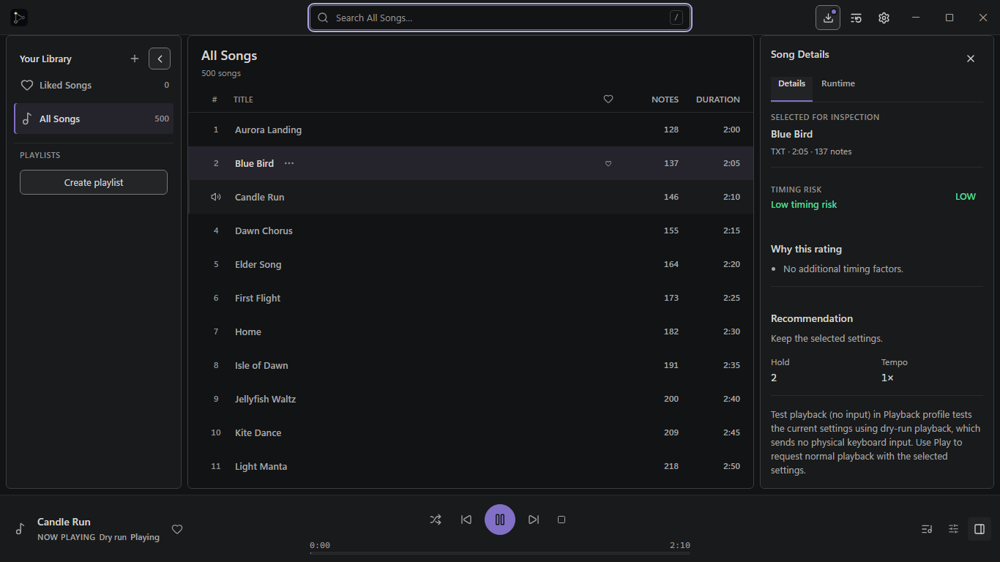
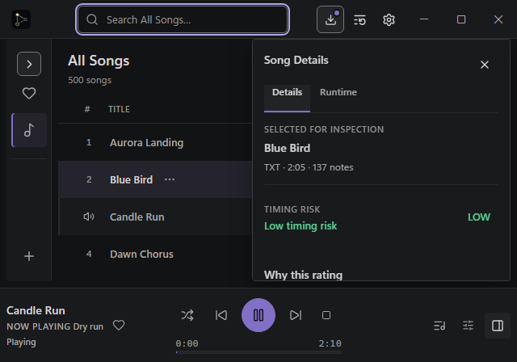
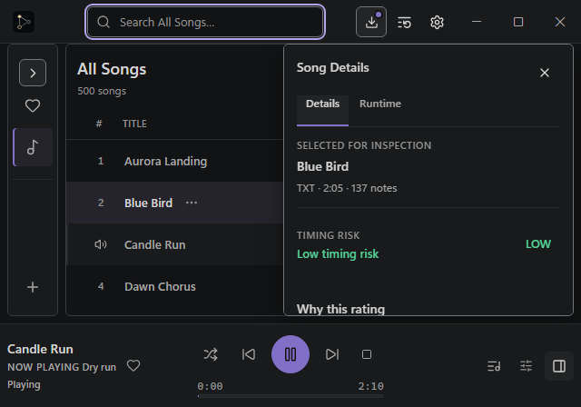
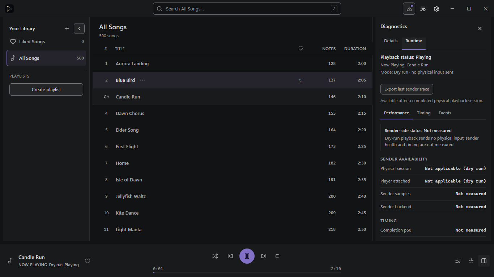

# Graphite v2.1 — Border Checkpoint B

**Status:** corrected border candidate; awaiting Lead visual review. The owner rejected the previous borderless checkpoint. This correction restores the locked outline system and does not approve the rest of V2 or Visual Gate #2.

The before images are the current PR #503 checkpoint at `f5c62f5e245fa56ee27f30c3f28a1c952b92b743`. The after images are the corrected candidate from the same Playwright app, fixture and states. Both sets use identical CSS viewport dimensions and data. These are genuine browser-rendered application captures with the existing mock playback bridge, not synthetic mockups and not native Tauri captures.

## Matched screenshot comparisons

### 1366 × 768 — populated workbench, docked Inspector

500-song library; expanded Navigator; Candle Run playing in Dry run while Blue Bird is selected; Search focused; Update visible; Song Details docked.

| Current checkpoint                                                                                                                                                                | Border-restored candidate                                                                                                                                                         |
| --------------------------------------------------------------------------------------------------------------------------------------------------------------------------------- | --------------------------------------------------------------------------------------------------------------------------------------------------------------------------------- |
| [PNG](checkpoint-current/populated-1366x768.png)<br> | [PNG](border-restored/populated-1366x768.png)<br> |

### 640 × 448 — compact overlay, focused Search and Dry run

Update visible; Search focused through `/`; compact, nonmodal Song Details overlay; Dry run clearly identified in the Player Dock.

| Current checkpoint                                                                                                                                                     | Border-restored candidate                                                                                                                           |
| ---------------------------------------------------------------------------------------------------------------------------------------------------------------------- | --------------------------------------------------------------------------------------------------------------------------------------------------- |
| [PNG](checkpoint-current/compact-640x448.png)<br> | [PNG](border-restored/compact-640x448.png)<br> |

### 1366 × 768 — Runtime Diagnostics, dry-run sender details

Candle Run remains the playing track while Blue Bird remains selected. Runtime includes the no-physical-input statement, sender availability, sender samples/backend and timing metrics.

| Current checkpoint                                                                                                                                                                            | Border-restored candidate                                                                                                                                                                |
| --------------------------------------------------------------------------------------------------------------------------------------------------------------------------------------------- | ---------------------------------------------------------------------------------------------------------------------------------------------------------------------------------------- |
| [PNG](checkpoint-current/runtime-dry-run-1366x768.png)<br> | [PNG](border-restored/runtime-dry-run-1366x768.png)<br> |

Captured computed styles and element bounds: [current checkpoint JSON](checkpoint-current/computed-styles.json) · [restored candidate JSON](border-restored/computed-styles.json).

## Computed border and geometry checks

At 1366 CSS px, Navigator, Track Browser and docked Inspector each compute to four `1px` borders, `rgb(58, 61, 64)` (`#3A3D40`), `6px` radius and `box-sizing: border-box`. Docked pane `box-shadow` computes to `none`; each pane therefore has one outline with no duplicate inset stroke.

At 640 CSS px, the compact Inspector computes to four `1px` borders, `rgb(114, 119, 125)` (`#72777D`), `6px` radius and `box-sizing: border-box`. Its existing shadow remains `0 10px 28px rgba(0, 0, 0, 0.34)`. The outer edge remains a pointer hit target.

| Viewport   | Pane              |             x, y | width × height |                            right / bottom |
| ---------- | ----------------- | ---------------: | -------------: | ----------------------------------------: |
| 1366 × 768 | Navigator         |            8, 48 |      240 × 620 |                                 248 / 668 |
| 1366 × 768 | Track Browser     |          256, 48 |      774 × 620 |                                1030 / 668 |
| 1366 × 768 | Docked Inspector  |         1038, 48 |      320 × 620 |                                1358 / 668 |
| 1366 × 768 | Resize gutters    | x=248 and x=1030 |       8px each |                      no pane intersection |
| 640 × 448  | Compact Inspector |          312, 48 |      320 × 300 |                                 632 / 348 |
| 640 × 448  | Workbench bottom  |                — |              — | 356; overlay retains 8px bottom clearance |

The before/after pane and overlay bounding boxes are unchanged. The compact overlay remains at least 280px wide, stays below the titlebar and above the Player Dock, and has no horizontal page overflow. Browser checks hit-test the Navigator and overlay outline points inside their pane targets. Existing workbench E2E checks exercise pointer resizing, persisted widths, overlay transitions, independent scrolling, and the virtualized library.

Computed internal dividers remain `1px #2A2B2C`. The content/rail split remains `#121314` / `#191A1B`. The current checkpoint computed docked pane edges as `0px` / `0px` radius and used inset side shadows; its compact edge was `1px #393B3E` / `4px` radius. No other visual token or typography changes were made for this correction.

## Design decision report

- **Palette:** Track Browser `#121314`; Navigator, Inspector and chrome `#191A1B`; structural divider `#2A2B2C`; pane edge `#3A3D40`; compact overlay edge `#72777D`. Accent and selected-state colors are unchanged. Purple remains limited to existing meaningful active/focus/primary states.
- **Text hierarchy:** unchanged from the current v2.1 checkpoint. Computed examples: Navigator heading `13px/600`, navigation labels `13px/500`, regular song title `13px/500`, selected song title `13px/600`, metadata `12px/400`, Inspector heading `14px/600`, Runtime primary status `13px/600`.
- **Component emphasis and density:** the Browser stays the darkest primary surface, with lighter secondary rails. Border restoration makes the three work areas visibly distinct without changing their widths, 8px gutters, 46px virtual rows, 92px Player Dock or text density.
- **Visual compromise / contrast:** exact owner-locked outline colors were retained. Computed contrast for `#3A3D40` is `1.70:1` against the Browser (`#121314`) and `1.59:1` against rails (`#191A1B`). The compact edge `#72777D` is `3.86:1` against its Inspector surface. The internal `#2A2B2C` divider is `1.31:1` against content and `1.23:1` against rails. These structural edges are subdued by specification; please tell us if any must be classified as essential non-text indicators under the 3:1 requirement. No replacement color has been chosen here.

### Remaining differences against issue #501

This checkpoint only corrects pane edges and proves their geometry in the three requested states. It does not claim the full V2 visual package is complete or accepted.

- Settings, menus, dialogs, playback-profile popovers, warnings and other overlays have not been brought through a full visual audit against the locked V2 grammar in this checkpoint.
- Empty library, empty playlist, imported playlist, physical playback, pending confirmation, recovery, uncertain native status, degraded diagnostics, collapsed Navigator, keyboard-focused menus/Settings, and the 800 / 1024 / 1920 screenshots have not been recaptured here.
- Dedicated titlebar, song-row, Inspector and Player Dock close-ups and the full evidence matrix remain outstanding.
- Browser DPR tests are simulated Chromium coverage; they are not physical Windows DPI validation. Native Tauri evidence is reported separately below if the local run succeeds.

## Reproducing the local Tauri preview

V2 code is on the existing feature branch and is not included in `main` or a published installer. The branch was fetched from `origin`; its local and remote heads matched before this correction. For an exact reproduction, compare the checkout with the **current `headRefOid` on Draft PR #503** before launching. The corrected application source SHA used by the native capture is `b02e951dd13f93ca6697f7538cadb5e7c3b05928`; an evidence-only commit may be on top of that source commit. The historical checkpoint SHA above is the before-image source.

From PowerShell at the repository root:

```powershell
git status --short --branch
git fetch origin main feat/desktop-graphite-workbench-polish
git switch feat/desktop-graphite-workbench-polish
git rev-parse HEAD
git rev-parse origin/feat/desktop-graphite-workbench-polish
```

The two `rev-parse` values must match the current Draft PR #503 head SHA. If the working tree has local changes, preserve them before switching; do not reset or delete user data. Then launch from `desktop/`:

```powershell
Set-Location D:\Dev\Sky-Auto-Player\desktop
bun run tauri:dev
```

Graphite is the default only for newly initialized appearance settings. Existing saved palettes remain unchanged. In the running app, select **Settings → Appearance → Graphite** to persist it for this user. If an older dev window is still open, close that window and stop its own terminal with `Ctrl+C`, verify the branch and SHA again, then relaunch. Do not clear the app's settings or data to force the palette.

### Native Tauri capture

Captured from the actual Windows `sky_desktop_shell.exe` window at application source HEAD `b02e951dd13f93ca6697f7538cadb5e7c3b05928`. After closing the pre-existing dev window and releasing its stale Vite server on port 1420, a clean `bun run tauri:dev` from `desktop/` started Vite and compiled/launched the native app. The running app read the existing `%LOCALAPPDATA%\io.github.pumni.skyautoplayer\config.json`; its saved palette was already `graphite`. This was a read-only check; no app settings or user data were changed. The capture is the maximized native window at 1936 × 1096 host pixels, with the user's real 96-song library. It is supplementary native evidence, not part of the fixture-matched Playwright pairs.

[Actual Tauri dev window PNG](border-restored/native-tauri-window.png)

The first launch attempt found the pre-existing Vite server on port 1420; closing the old app and stopping its dev process released the port. The clean run then reached the native `Running sky_desktop_shell.exe` stage. After capturing, the dev terminal was stopped with `Ctrl+C` and the app window closed. Another full-screen application remained foreground, so the app was not raised or sent input; Windows `PrintWindow` captured only the Sky Auto Player window. This verifies native launch and appearance at the host's maximized size, not physical DPI, titlebar drag or native input behavior.

## Verification evidence

- Current checkpoint capture: `$env:GRAPHITE_CORRECTION_VARIANT='checkpoint-current'; bun run test:e2e visual-correction-checkpoint.spec.ts --reporter=line`.
- Corrected capture plus exact pane edge/radius, 8px gutter, hit-target and overlay geometry checks: `$env:GRAPHITE_CORRECTION_VARIANT='border-restored'; bun run test:e2e visual-correction-checkpoint.spec.ts --reporter=line`.
- Workbench and palette E2E: `bun run test:e2e workbench.spec.ts palette-appearance.spec.ts --reporter=line` — passed 11 tests.
- Virtualization and both resizer pointer checks: `bun run test:e2e library.spec.ts --grep "virtualized library pages beyond the first 200 songs|Library separator resizes by pointer and persists after reload|Diagnostics utility separator follows pointer and keyboard direction" --reporter=line` — passed 3 tests.
- TypeScript: `bun run typecheck` — passed.
- Production bundle, canonical `cargo xtask check all`, full V2 evidence and hosted required CI remain for the accepted full package; they were not run at this visual checkpoint.

## Review request

Please review only whether the restored outlines, overlay edge, corner radii, contrast tradeoff and unchanged 8px geometry match the owner correction. Request changes if the border weight, visibility or compact boundary needs direction. Do not treat this checkpoint as approval of the remainder of V2 or Visual Gate #2.
