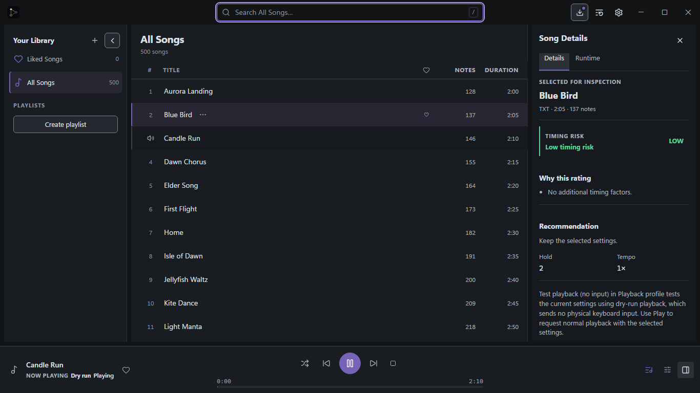
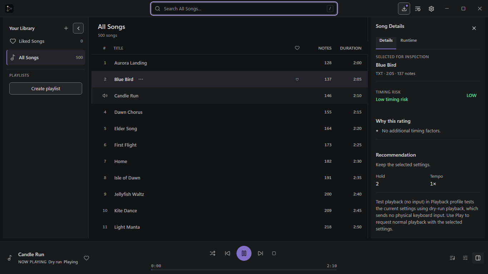
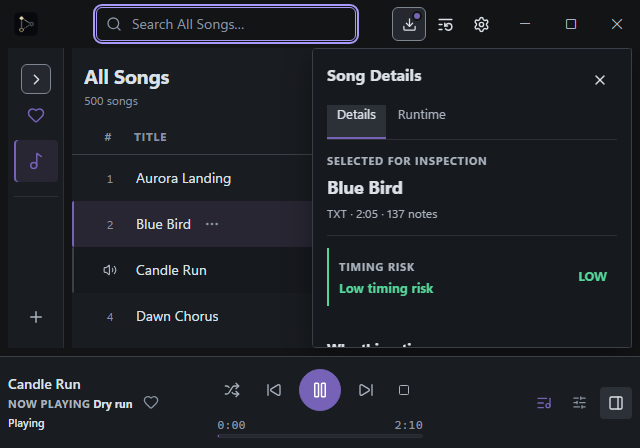
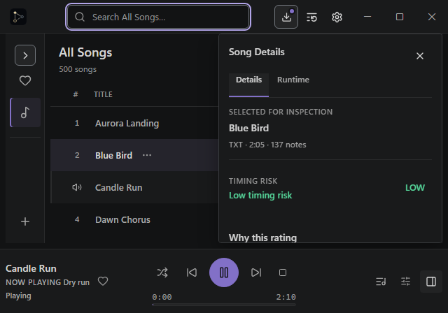
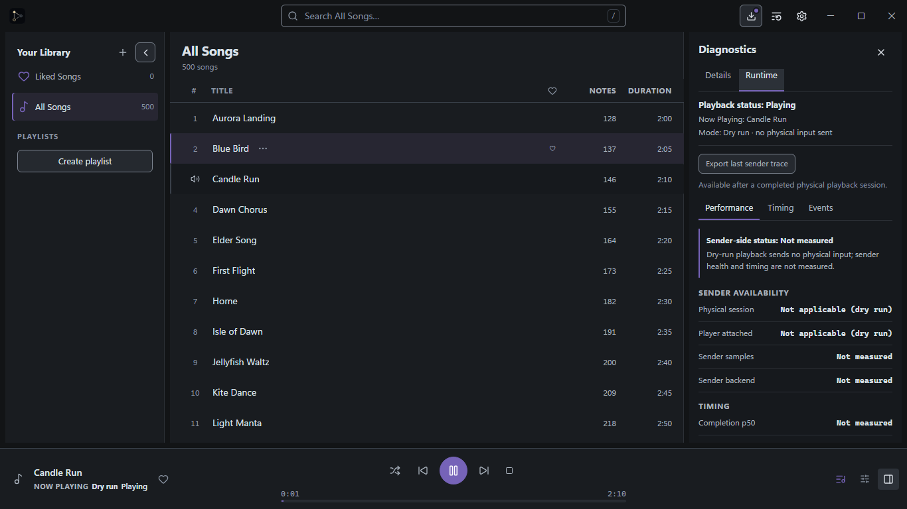
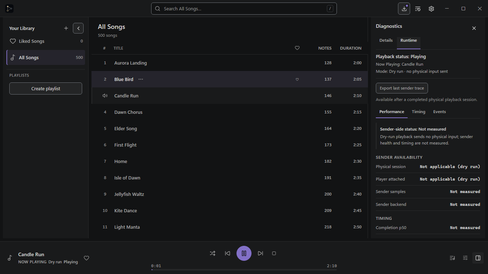

# Border-restoration checkpoint

**Current review package:** [BORDER-CHECKPOINT.md](BORDER-CHECKPOINT.md). This is the owner-requested comparison of the rejected borderless checkpoint against the restored Graphite pane outlines. The new captures, computed styles, local Tauri preview instructions, and remaining-differences inventory are in that file.

The Checkpoint A material below is retained as historical evidence only. The owner rejected its borderless appearance; it is not an approved V2 visual direction.

## Archived: original Checkpoint A

**Status:** candidate for Lead visual review. This is not Visual Gate #2 and does not authorize the remaining V2 styling.

The left images show the real PR #503 appearance at reviewed source `1fae9f5318519dd708cf8a1f810716aab94dc70c`. The right images show the corrected Graphite v2.1 candidate rendered from this branch. Both sets use the same Playwright fixture, catalog, selected/playing songs, Inspector state, and CSS viewport. They are captures of the application, not mockups.

## Matched Playwright comparisons

### 1366 × 768 — 500-song library, A playing while B is selected, docked Inspector

The Navigator is expanded. Candle Run is playing in dry-run while Blue Bird is selected for inspection. Search is focused and Update is visible.

| PR #503 current                                                                                                                                            | Graphite v2.1 candidate                                                                                                                                    |
| ---------------------------------------------------------------------------------------------------------------------------------------------------------- | ---------------------------------------------------------------------------------------------------------------------------------------------------------- |
| [Full-size PNG](pr-current/populated-1366x768.png)  | [Full-size PNG](candidate/populated-1366x768.png)  |

### 640 × 448 — Update visible, keyboard-focused Search, overlay Inspector, Dry run

The compact overlay remains inside the workbench bounds. Search receives focus through the `/` keyboard shortcut. The dock explicitly identifies Dry run.

| PR #503 current                                                                                                                                     | Graphite v2.1 candidate                                                                                                                             |
| --------------------------------------------------------------------------------------------------------------------------------------------------- | --------------------------------------------------------------------------------------------------------------------------------------------------- |
| [Full-size PNG](pr-current/compact-640x448.png)  | [Full-size PNG](candidate/compact-640x448.png)  |

### 1366 × 768 — Runtime Diagnostics, dry-run sender details

Candle Run is playing while Blue Bird remains selected. Runtime shows the no-physical-input statement, sender availability, sender sample/backend values, and timing metrics.

| PR #503 current                                                                                                                                                                 | Graphite v2.1 candidate                                                                                                                                                                    |
| ------------------------------------------------------------------------------------------------------------------------------------------------------------------------------- | ------------------------------------------------------------------------------------------------------------------------------------------------------------------------------------------ |
| [Full-size PNG](pr-current/runtime-dry-run-1366x768.png)  | [Full-size PNG](candidate/runtime-dry-run-1366x768.png)  |

The captured computed styles are available for the [current PR](pr-current/computed-styles.json) and [candidate](candidate/computed-styles.json). The candidate screenshot files are exactly 640 × 448 or 1366 × 768 pixels as named.

## Locked palette and rendered roles

| Role                                        | Candidate value                   | Use in these captures                                    |
| ------------------------------------------- | --------------------------------- | -------------------------------------------------------- |
| Track Browser canvas                        | `#121314`                         | Main content and Search field                            |
| Navigator, Inspector, titlebar, Player Dock | `#191A1B`                         | Secondary workbench rails and chrome                     |
| Raised surface                              | `#242526`                         | Raised controls                                          |
| Hover / pressed                             | `#222324` / `#303133`             | Neutral interaction feedback                             |
| Selected row                                | `#25242C`                         | Selected Blue Bird background, without a purple stripe   |
| Structural divider                          | `#2A2B2C`                         | One-pixel pane, section, and dock boundaries             |
| Overlay edge / control boundary             | `#393B3E` / `#72777D`             | Compact Inspector edge / identifiable controls           |
| Primary / secondary / tertiary text         | `#D4D4D4` / `#A6A6A6` / `#929292` | Selected data / regular content / metadata               |
| Accent / hover / keyboard focus             | `#8270C7` / `#9281D4` / `#B2A5E9` | Meaningful active states / primary hover / focus-visible |
| Text on accent-filled primary control       | `#121314`                         | Player primary transport control                         |

The live computed backgrounds are titlebar `rgb(25, 26, 27)`, Navigator `rgb(25, 26, 27)`, Track Browser `rgb(18, 19, 20)`, Inspector `rgb(25, 26, 27)`, and Player Dock `rgb(25, 26, 27)`. Search has a one-pixel `rgb(114, 119, 125)` boundary and a two-pixel `rgb(178, 165, 233)` focus ring. Candidate selected and playing row backgrounds compute to `rgb(37, 36, 44)` and `rgb(25, 26, 27)` respectively.

## Computed text hierarchy

| Component                                      | Candidate computed size / weight     | Role                                   |
| ---------------------------------------------- | ------------------------------------ | -------------------------------------- |
| Navigator title                                | 13px / 600                           | Primary rail heading                   |
| Navigator items                                | 13px / 500                           | Regular navigation labels              |
| Playlist group label                           | 11px / 600, 0.04em tracking          | Quiet section label                    |
| Track Browser heading                          | 18px / 600                           | Main page heading                      |
| Result count                                   | 12px / 400                           | Tertiary metadata                      |
| Column headings                                | 11px / 600                           | Secondary labels                       |
| Regular / selected song title                  | 13px / 500 / 13px / 600              | Secondary / primary content            |
| Inspector title / tabs                         | 14px / 600 / 12px / 500              | Utility hierarchy                      |
| Selected song heading                          | 14px / 600                           | Inspector primary data                 |
| Runtime status / sender status / metric values | 13px / 600 / 12px / 600 / 12px / 600 | Clear diagnostics without larger cards |
| Player track / identity and Dry run            | 14px / 600 / 11px / 600              | Playback identity and mode             |

The captured song rows remain exactly 46px high, and the Player Dock remains 92px high. The font stack remains Segoe UI Variable / Segoe UI.

## Design decisions in this checkpoint

- **Surface depth:** the Track Browser is now the darkest and largest surface; Navigator, Inspector, titlebar, and Player Dock share the lighter neutral role from the locked reference.
- **Text hierarchy:** ordinary song names use secondary text at 13px/500. Blue Bird's selected row uses primary text at 13px/600 and a restrained neutral-violet background. Candle Run stays on a subdued neutral row with the speaker icon as its Now Playing marker.
- **Accent use:** the selected source keeps one leading indicator, the selected Inspector tab keeps its active underline, Search keeps one keyboard ring, and the primary transport keeps its filled accent. Now Playing and enabled utility icons no longer add purple accents.
- **Diagnostics:** healthy low risk has no colored rail or banner. Runtime retains explicit dry-run wording and sender values that say “Not measured”; no sender measurements are invented.

## Contrast evidence and direction needed

Measured text and active states pass the stated thresholds in the captured roles: `#D4D4D4` on selected `#25242C` is 10.36:1, `#A6A6A6` on content `#121314` is 7.64:1, `#929292` on rail `#191A1B` is 5.60:1, and `#121314` on accent `#8270C7` is 4.51:1. The focus ring is 8.37:1 on the content canvas and 7.84:1 on chrome.

The locked neutral boundary values are lower if either is classified as essential non-text UI: the overlay edge `#393B3E` against Inspector `#191A1B` is 1.55:1; the structural divider `#2A2B2C` against content `#121314` is 1.31:1. In this candidate the overlay edge is paired with a shadow and the dividers are decorative; interactive focus has its separate high-contrast ring. Please confirm whether that classification meets the 3:1 non-text requirement. If the overlay edge must itself meet 3:1, the smallest change using an already locked token would be `#72777D` for that edge only (3.86:1 against `#191A1B`); the same token on a content divider is 4.12:1 but would make that decorative rule substantially stronger. I have not applied either change without art-direction approval.

## Remaining differences against issue #501

This checkpoint changes only the Graphite token map and the titlebar/workbench/Navigator/Track Browser/Inspector/Runtime/Player Dock appearance visible in the three requested states. It does not claim the full V2 acceptance matrix.

- Settings, confirmation dialogs, menus, and playback-profile popovers still have the existing V2 component treatments. Their surface roles, outlines, and radii have not yet been brought to the locked raised-surface and 4–6px dialog/menu grammar.
- Empty library, empty playlist, imported playlist, physical playback, pending confirmation, recovery, uncertain native status, degraded Runtime, collapsed Navigator, and keyboard-focused menu/Settings states have not been recaptured in this checkpoint.
- The compact Inspector and docked Inspector are shown, but dedicated titlebar, row, Inspector, and Player Dock crops are deferred.
- `titlebar.spec.ts` simulates 100%, 125%, and 150% device scale factors in Chromium. This is not a physical Windows DPI or native drag-region test.
- The locked overlay edge and structural divider have the contrast concern described above; Lead direction is requested before the candidate is spread to more screens.

## Verification at Checkpoint A

- `$env:GRAPHITE_CORRECTION_VARIANT='pr-current'; bun run test:e2e visual-correction-checkpoint.spec.ts --reporter=line` — passed before appearance edits at reviewed PR source `1fae9f5318519dd708cf8a1f810716aab94dc70c`; 3 matched current screenshots plus computed-style capture.
- `$env:GRAPHITE_CORRECTION_VARIANT='candidate'; bun run test:e2e visual-correction-checkpoint.spec.ts --reporter=line` — passed on the candidate source; 3 screenshots, compact overlay bounds/overflow, playback identity, and exact rendered token/typography assertions.
- `bun run test:e2e palette-appearance.spec.ts --reporter=line` — passed, 4 tests; all six palettes, Graphite tokens, contrast checks, settings persistence, Axe serious/critical checks, forced colors, and reduced motion.
- `bun run test:e2e titlebar.spec.ts --reporter=line` — passed; titlebar collision, pointer operation, Update available/unavailable, long labels, five viewport widths, and simulated 100/125/150% scale factors.
- `bun run typecheck` — passed (`tsc --noEmit`).
- Production-bundle smoke and `cargo xtask check all` are intentionally deferred until the Lead accepts this visual checkpoint and the full V2 package is complete.

## Lead review request

Please review the three matched pairs and decide whether to accept the v2.1 workbench hierarchy for continuation. In particular, confirm the content/rail brightness split, selected-versus-playing distinction, accent budget, compact titlebar/Search/overlay/Dry run, and the classification of the locked 1.55:1 overlay edge and 1.31:1 structural divider. After direction is recorded, implementation can continue across the remaining V2 states. Visual Gate #2 remains pending.
