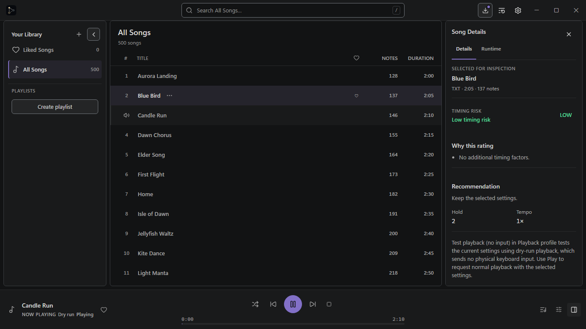
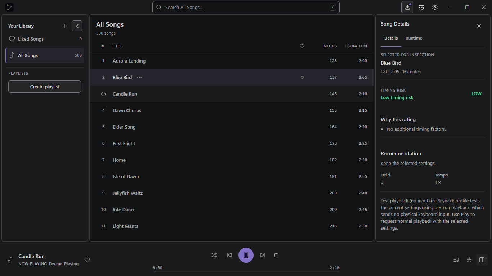
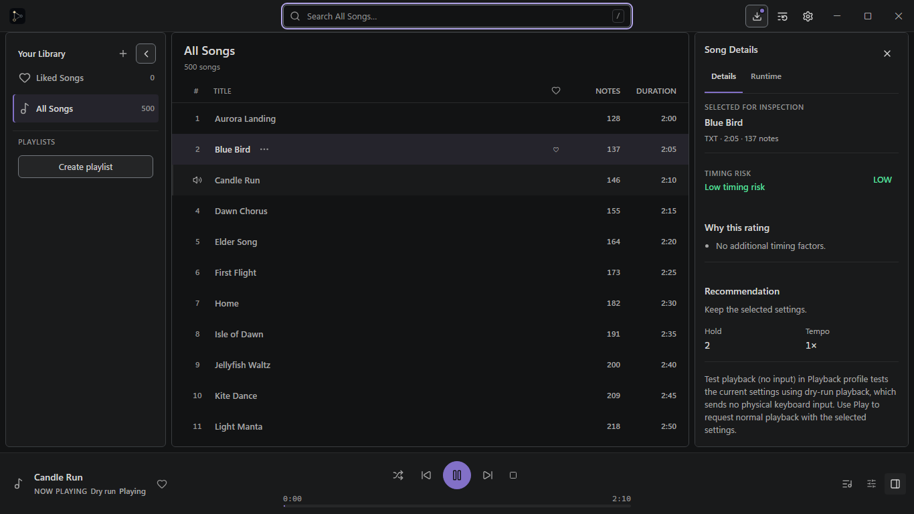
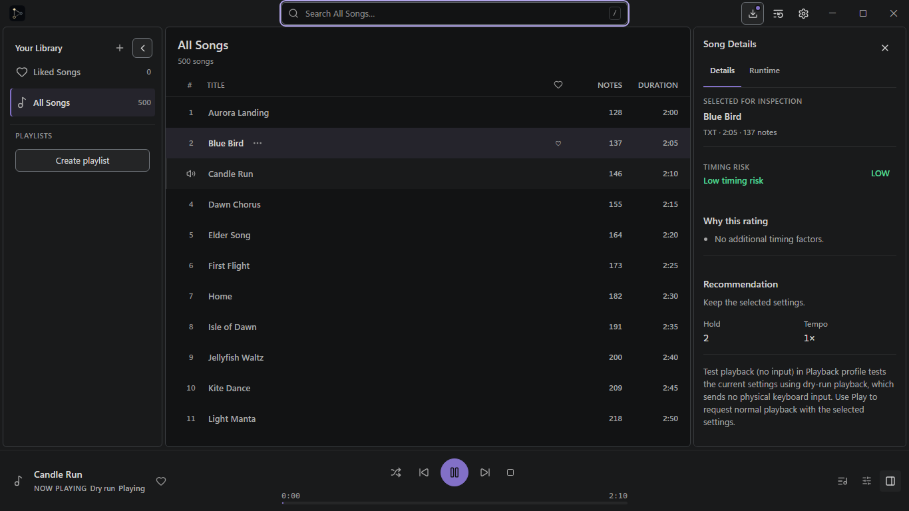
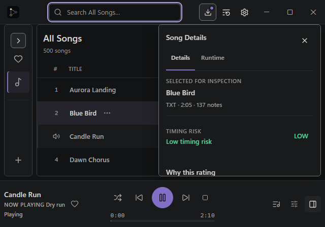
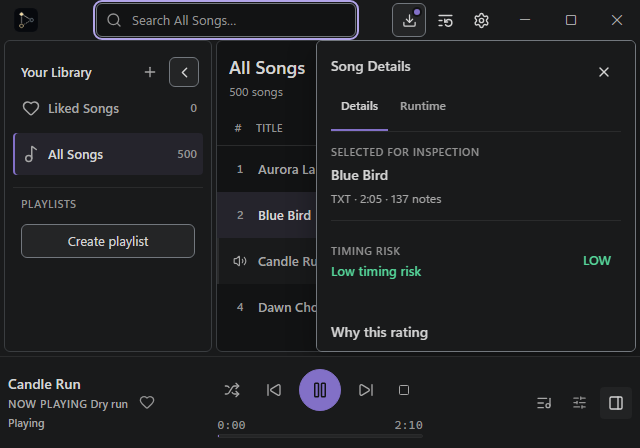
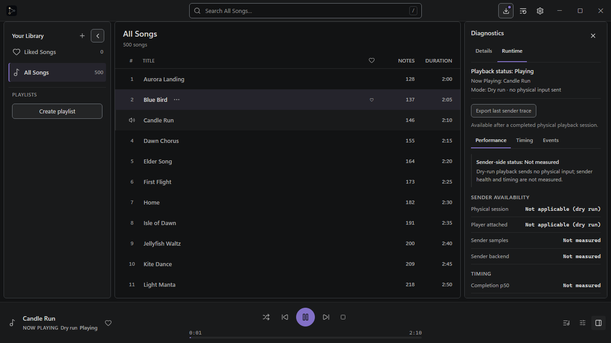
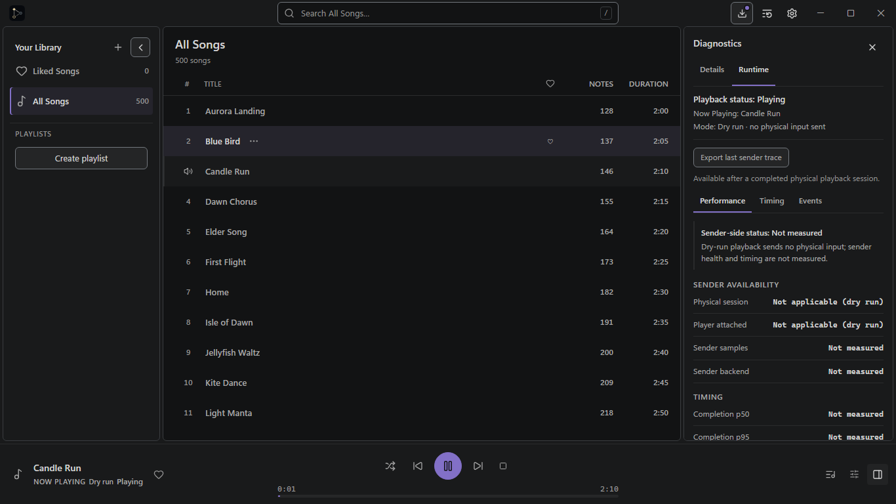

# Graphite v2.1 — Chrome Continuity Checkpoint C

**Status:** candidate for Lead visual review. This checkpoint applies the owner-locked chrome and 4px workbench geometry to the existing PR #503 branch. It is not approval of Visual Gate #2, the remaining V2 polish, or a merge.

The before images use the reviewed PR #503 source `6ab47591b5629c406b65d4ceed5e3d63ab590fcb` (`previous-border-restored`). The after images use the corrected Graphite application source committed as `9bb6588e5dfc2c71f8c3176ab6527e743ca69673` on `feat/desktop-graphite-workbench-polish`. Both sets were generated by the same Playwright application and mock bridge with the same fixture, playback state, selected song, Inspector state, Search state, and CSS viewport. They are application screenshots, not synthetic mockups. Each CSS viewport is captured at Chromium DPR 1.

## Matched Playwright screenshots

### 1366 × 768 — populated workbench, Search unfocused

The library has 500 songs and an expanded Navigator. Candle Run (A) is playing in Dry run while Blue Bird (B) is selected. Song Details is docked, and Update is visible.

| Reviewed checkpoint                                                                                                                                                                                                                           | 4px candidate                                                                                                                                                                                                       |
| --------------------------------------------------------------------------------------------------------------------------------------------------------------------------------------------------------------------------------------------- | ------------------------------------------------------------------------------------------------------------------------------------------------------------------------------------------------------------------- |
| [PNG](checkpoint-c/previous-border-restored/populated-unfocused-1366x768.png)<br> | [PNG](checkpoint-c/candidate/populated-unfocused-1366x768.png)<br> |

### 1366 × 768 — same workbench, keyboard-focused Search

The `/` shortcut moves keyboard focus to Search. Update stays visible and the purple focus ring remains the only new focus accent.

| Reviewed checkpoint                                                                                                                                                                                                                                            | 4px candidate                                                                                                                                                                                                                        |
| -------------------------------------------------------------------------------------------------------------------------------------------------------------------------------------------------------------------------------------------------------------- | ------------------------------------------------------------------------------------------------------------------------------------------------------------------------------------------------------------------------------------ |
| [PNG](checkpoint-c/previous-border-restored/populated-search-focused-1366x768.png)<br> | [PNG](checkpoint-c/candidate/populated-search-focused-1366x768.png)<br> |

### 640 × 448 — compact Inspector overlay, focused Search, Dry run

Update is visible, Search is focused through `/`, the Inspector is the compact overlay, and the Player Dock explicitly identifies Dry run.

| Reviewed checkpoint                                                                                                                                                                                                                           | 4px candidate                                                                                                                                                                                                       |
| --------------------------------------------------------------------------------------------------------------------------------------------------------------------------------------------------------------------------------------------- | ------------------------------------------------------------------------------------------------------------------------------------------------------------------------------------------------------------------- |
| [PNG](checkpoint-c/previous-border-restored/compact-overlay-640x448.png)<br> | [PNG](checkpoint-c/candidate/compact-overlay-640x448.png)<br> |

### 1366 × 768 — Runtime Diagnostics

Candle Run remains playing while Blue Bird remains selected. Runtime displays the no-physical-input statement, sender availability, samples, backend and timing metrics.

| Reviewed checkpoint                                                                                                                                                                                                                                            | 4px candidate                                                                                                                                                                                                                        |
| -------------------------------------------------------------------------------------------------------------------------------------------------------------------------------------------------------------------------------------------------------------- | ------------------------------------------------------------------------------------------------------------------------------------------------------------------------------------------------------------------------------------ |
| [PNG](checkpoint-c/previous-border-restored/runtime-diagnostics-dry-run-1366x768.png)<br> | [PNG](checkpoint-c/candidate/runtime-diagnostics-dry-run-1366x768.png)<br> |

Full computed values are in [reviewed checkpoint JSON](checkpoint-c/previous-border-restored/computed-styles.json) and [candidate JSON](checkpoint-c/candidate/computed-styles.json).

## Computed colors and geometry

The candidate computes the continuity plane to `rgb(25, 26, 27)` (`#191A1B`) across the app shell, titlebar, Navigator, Inspector, and Player Dock. The Track Browser computes to `rgb(18, 19, 20)` (`#121314`). The titlebar is 40px high with a 0px bottom border. The Player Dock remains 92px high and has one 1px `#2A2B2C` top divider.

| Candidate viewport | Element                   |    Bounding box (x, y, width × height) | Edge / radius                       |
| ------------------ | ------------------------- | -------------------------------------: | ----------------------------------- |
| 1366 × 768         | Navigator                 |                     `4, 40, 240 × 632` | `1px #3A3D40`, 6px                  |
| 1366 × 768         | Track Browser             |                   `248, 40, 790 × 632` | `1px #3A3D40`, 6px                  |
| 1366 × 768         | Docked Inspector          |                  `1042, 40, 320 × 632` | `1px #3A3D40`, 6px                  |
| 1366 × 768         | Resizer slots             | `x=244` and `x=1038`, 4px visual width | 8px pointer hit width               |
| 640 × 448          | Navigator                 |                     `4, 40, 208 × 312` | `1px #3A3D40`, 6px                  |
| 640 × 448          | Track Browser             |                   `216, 40, 420 × 312` | `1px #3A3D40`, 6px                  |
| 640 × 448          | Compact Inspector overlay |                   `316, 40, 320 × 312` | `1px #72777D`, 6px, existing shadow |
| Both               | Outside workbench inset   |              left/right/bottom = `4px` | —                                   |

The actual pane-to-pane gaps and CSS solver gutter are 4px in Graphite. Workbench padding supplies the exact 4px outside and bottom insets. The titlebar begins at y=0; the workbench begins at y=40. At 1366×768 it ends at y=676 and the dock begins at y=676. At 640×448 the workbench ends at y=356 and the dock begins at y=356. The overlay stays within the workbench at y=40–352.

The solver now receives the active palette. Graphite uses 4px geometry; the five existing palettes retain their prior 8px solver/CSS geometry. Stored Navigator and Inspector widths and their persistence format are unchanged. CSS widens each 4px separator hit area by 2px on both sides without increasing the visual slot. `elementFromPoint` hit-tested all three sample points at each separator (`1.5px` left, center, `1.5px` right) in the candidate; the previous 8px slot hit-tested only its center sample. Browser resize E2E continues to exercise actual pointer resize and keyboard separator control.

All captured candidate documents fit the viewport: document and body scroll widths are exactly 1366px or 640px; `data-layout-fits="true"`. The docked panes each compute four 1px borders in `rgb(58, 61, 64)` (`#3A3D40`), radius 6px, no box shadow. The compact overlay computes four 1px borders in `rgb(114, 119, 125)` (`#72777D`), radius 6px, and retains `0 10px 28px rgba(0, 0, 0, 0.34)`.

Interior structural rules remain `#2A2B2C`. These subdued owner-locked dividers have 1.31:1 contrast against the content plane and 1.23:1 against chrome; the docked pane edge has 1.70:1 against content and 1.59:1 against chrome. The overlay edge is 3.86:1 against its surface. This checkpoint does not change the specified colors. Lead should confirm whether the subdued structural lines are decorative for the non-text contrast requirement; no replacement color is proposed.

## Player Dock CI failure diagnosis

The two failures in Actions run `39406026315` expected the five earlier palettes' active Shuffle and Auto Play icon color to remain purple. Graphite deliberately uses a quieter neutral active state under the approved accent budget: pressed Shuffle uses primary text, pressed Auto Play uses secondary text, and their off states use the next lower text tier. `aria-pressed`, button names, visible state difference, hover/focus feedback and keyboard/pointer toggles remain intact. The updated E2E checks the state and layout behavior for Graphite and verifies that all five existing palettes retain their accent active-state behavior. The failure was a palette-blind expectation, not a playback behavior regression.

## Native Tauri capture

The paired comparisons above are browser-rendered screenshots. [This separate PNG](checkpoint-c/native/tauri-dev-local-graphite.png) is a genuine Windows Tauri `sky_desktop_shell.exe` window capture made with Win32 `PrintWindow`; `GetWindowRect` measured 800 × 560 host pixels. It shows the user's actual 96-song library, docked Inspector, and the locally persisted Graphite palette. The application window was already attached to this worktree's Vite dev server on port 1420, so it is useful as a native preview but is not fixture-matched evidence and is not used for the CSS viewport geometry assertions.

I attempted a clean second native launch with a separate Rust target, app-data root and WebView2 data folder. The native binary compiled, then the application's single-instance guard rejected the new process because PID 17060 was already running. I left that session and the user's saved settings untouched. The isolated attempt therefore provides no separate native startup/geometry verification.

The local preview instructions are the same for a native launch from the current PR checkout:

```powershell
git fetch origin main feat/desktop-graphite-workbench-polish
git switch feat/desktop-graphite-workbench-polish
git status --short --branch
git rev-parse HEAD
git rev-parse origin/feat/desktop-graphite-workbench-polish
```

The expected application source SHA for this checkpoint is `9bb6588e5dfc2c71f8c3176ab6527e743ca69673`; the branch's evidence-only commit can be a descendant. Compare local `HEAD` with the exact feature branch head shown on Draft PR #503 and confirm it contains this source commit. Use the same latest branch SHA; do not switch to `main` or a historical checkpoint. Then launch the existing Tauri dev workflow from `desktop/`:

```powershell
Set-Location D:\Dev\Sky-Auto-Player\desktop
bun run tauri:dev
```

Graphite is the default only when appearance settings are first initialized. Existing saved palette choices remain in place; to persist Graphite for an existing user, choose **Settings → Appearance → Graphite** in the running app. The local profile used for the native capture already reported `graphite`. Do not clear settings to force the preview. Close an older dev window and its owning terminal if it is serving stale code, then verify the checkout and relaunch.

## Remaining differences against issue #501

This is a geometry/chrome checkpoint, not the full V2 visual package. The following V2 states and application areas have not been updated or captured for this checkpoint: Settings, dialogs, menus, playback-profile overlays and warnings; empty library/playlist and imported playlist; physical playback; pending confirmation, recovery and uncertain native status; degraded diagnostics; collapsed Navigator; and dedicated titlebar, song-row, Inspector and Player Dock crops. The 800×560, 1024×640 and 1920×1080 screenshot states are also deferred. The remaining full-application work stays behind Lead approval of this checkpoint.

Chromium device-scale coverage simulates the titlebar/resizer layouts; this is not physical Windows DPI validation. The native Tauri capture, if available, is not equivalent to physical DPI or native drag-region acceptance.

## Verification at Checkpoint C

- Previous source matched captures and geometry: `$env:GRAPHITE_CHROME_CHECKPOINT_VARIANT='previous-border-restored'; bun run test:e2e chrome-continuity-checkpoint.spec.ts --reporter=line` — 1 passed at `6ab47591b5629c406b65d4ceed5e3d63ab590fcb`.
- Candidate matched captures, colors, 40px titlebar, 4px geometry, exact pane edges/radii, overlay bounds/shadow, resize acquisition points and no overflow: `$env:GRAPHITE_CHROME_CHECKPOINT_VARIANT='candidate'; bun run test:e2e chrome-continuity-checkpoint.spec.ts --reporter=line` — 1 passed.
- TypeScript: `bun run typecheck` — passed. Unit tests: `bun run test -- src/components/workbench/Workbench.test.tsx src/components/player/PlayerTransport.test.tsx` — 2 files, 26 tests passed.
- Titlebar regression: `bun run test:e2e titlebar.spec.ts --reporter=line` — 1 passed across 640, 800, 1024, 1366 and 1920px, Update available/unavailable, a long Search label, and simulated DPR 1, 1.25 and 1.5. The test checks nonintersection, pointer hit-testing, keyboard `/` focus and caret, Update/Reload/Settings/caption actions and horizontal overflow.
- Workbench and palette E2E: `bun run test:e2e workbench.spec.ts palette-appearance.spec.ts --reporter=line` — 11 passed, including all six palette contracts, Graphite settings persistence, overlay transitions, focus, forced colors and reduced motion.
- Responsive workbench and resize interaction: `bun run test:e2e library.spec.ts --grep "desktop workbench fits the supported viewport matrix|Library separator resizes by pointer and persists after reload|Diagnostics utility separator follows pointer and keyboard direction" --reporter=line` — 3 passed.
- Player Dock active states and geometry: `bun run test:e2e library.spec.ts --grep "dock and transport toggles show palette-specific active state without layout movement|Player Bar keeps a centered controls row and separate timeline at supported viewports" --reporter=line` — 2 passed.
- Formatting: Prettier check over every changed TypeScript/CSS/Markdown file passed after formatting the checkpoint report. `git diff --check` is run on the final commit candidate.
- Production-bundle smoke and canonical `cargo xtask check all` remain for after Lead acceptance and completion of the full V2 package.

## Review request

Please review the four matched pairs and computed JSON, focusing on continuity of the `#191A1B` chrome, 40px titlebar without a duplicate rule, true 4px gaps and insets, restored 1px pane outlines, overlay edge, and 8px resizer acquisition area. Confirm or request changes to the visual rhythm and the subdued structural-border contrast classification. Keep this PR Draft; Visual Gate #2 and issue #501 remain open.
