# Checkpoint E — Graphite local color balance

This checkpoint applies only the owner-locked color changes in OWNER CLARIFICATION E. It does not alter titlebar, pane, Inspector, or responsive geometry.

The **Before** captures reproduce reviewed PR #503 HEAD `b9dd15e5e6b027055af280c09a648b340db122ea`. They were rendered by Playwright from the live application with the original Graphite color tokens restored by a test-local CSS token override. The **Candidate** captures use the checked-in Graphite tokens. Both use the same mock library (500 songs), viewport, Update availability, and app state: Candle Run is playing in Dry run while Blue Bird is selected; the Inspector is docked except in the 640px overlay capture. The 120-second mock duration keeps playback progress steady during capture.

## Matched application captures

| State                              | PR #503 before                                                                            | Graphite color candidate                                                                        |
| ---------------------------------- | ----------------------------------------------------------------------------------------- | ----------------------------------------------------------------------------------------------- |
| 1366×768, Search unfocused         | 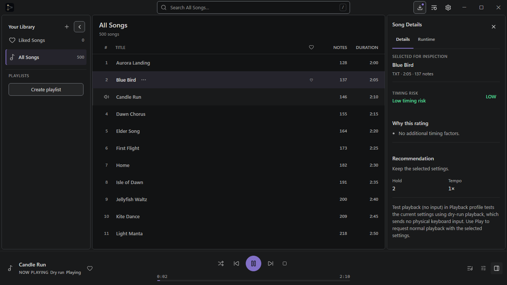 | 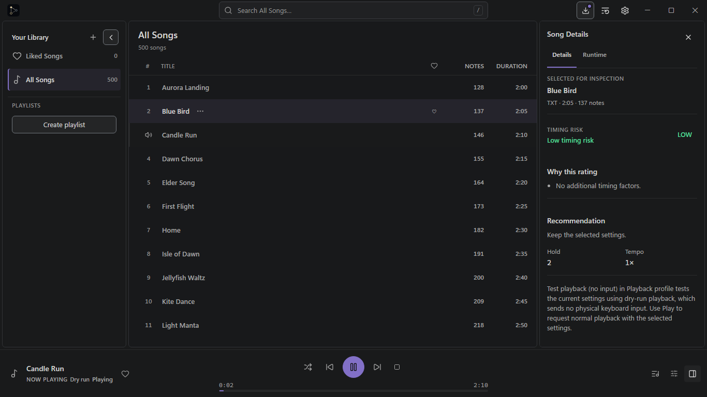 |
| 1366×768, keyboard-focused Search  | 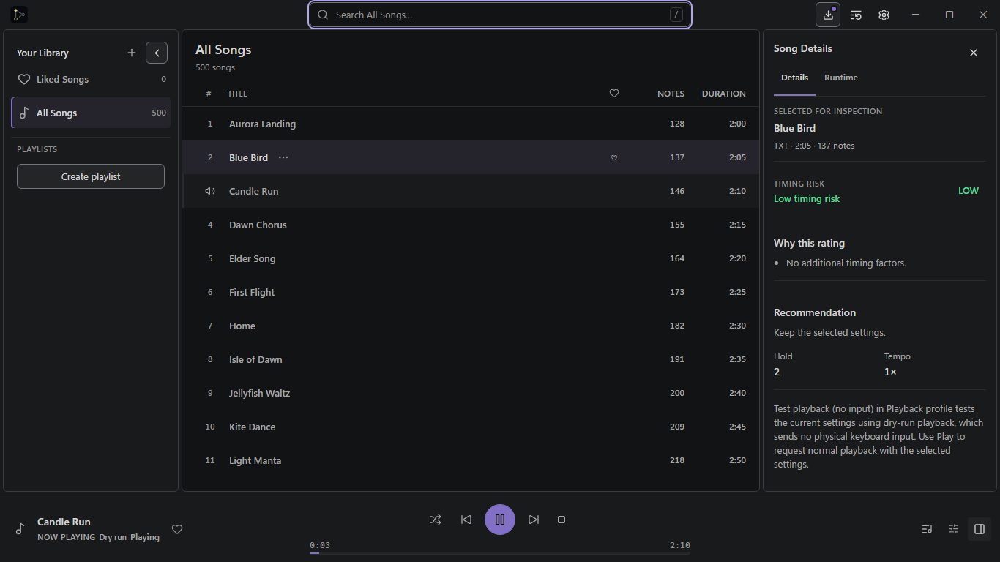     | 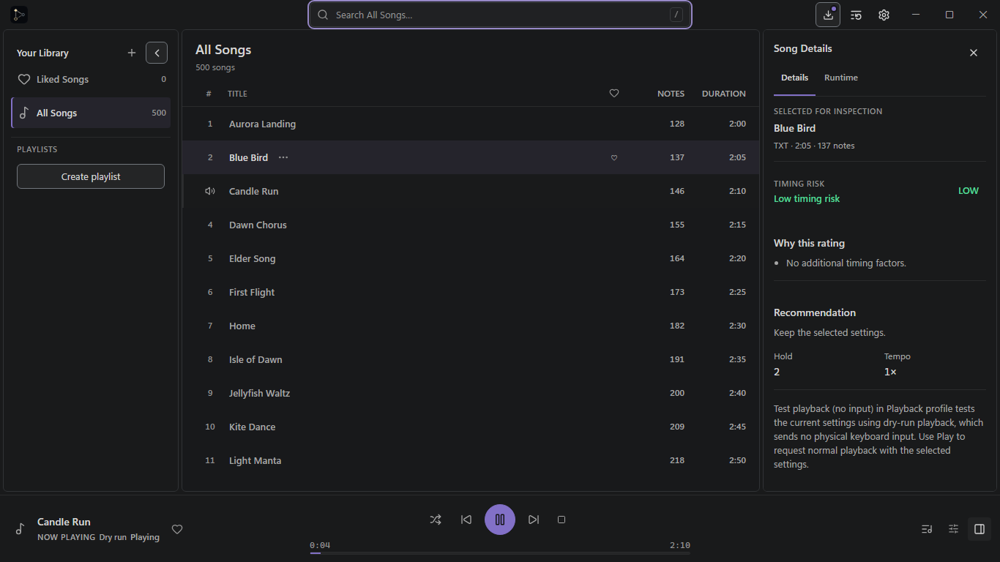     |
| 800×560, everyday workbench        | 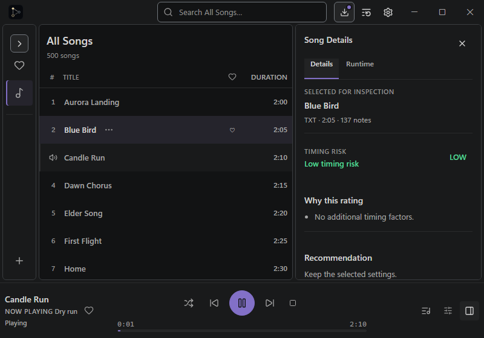                       | 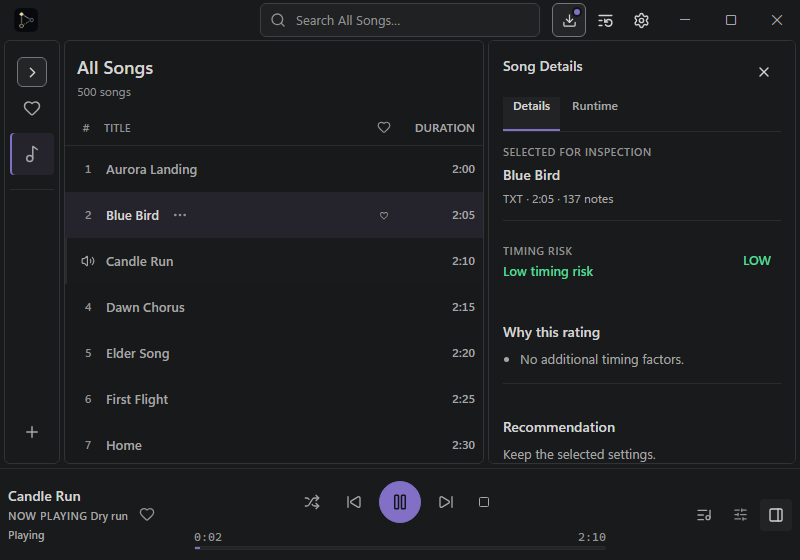                       |
| 640×448, compact Inspector overlay | 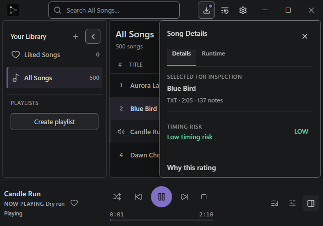                            | 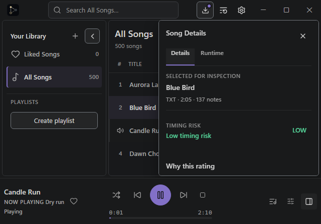                            |

The 640px state visibly identifies Dry run. The Navigator is expanded at that width in both captures; the remaining auto-collapse regression is documented below.

## Search and pane-edge close-ups

| Detail                    | PR #503 before                                                           | Graphite color candidate                                                       |
| ------------------------- | ------------------------------------------------------------------------ | ------------------------------------------------------------------------------ |
| Search, idle              | 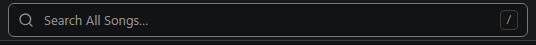          | 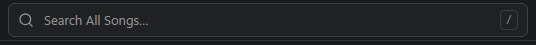          |
| Search, keyboard focus    | 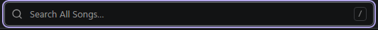           | 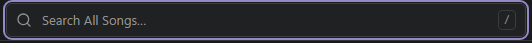           |
| Track Browser pane corner | 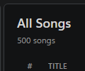 | 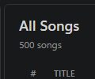 |

## Locked computed values

Computed styles are recorded for every state in [before evidence](before/computed-colors-and-accessibility.json) and [candidate evidence](candidate/computed-colors-and-accessibility.json).

| Role                                        | Candidate computed value                                                    |
| ------------------------------------------- | --------------------------------------------------------------------------- |
| Track Browser surface                       | `rgb(24, 25, 27)` (`#18191B`)                                               |
| Titlebar, Navigator, Inspector, Player Dock | `rgb(25, 26, 27)` (`#191A1B`)                                               |
| Docked pane border                          | `rgb(49, 51, 54)` (`#313336`), 1px, 6px radius                              |
| Search idle fill and edge                   | `rgb(32, 33, 35)` (`#202123`) / `rgb(61, 63, 67)` (`#3D3F43`), 1px          |
| Search keyboard focus                       | One 2px `rgb(150, 136, 198)` (`#9688C6`) outline, 1px offset, no box shadow |
| Other essential control boundary            | `rgb(114, 119, 125)` (`#72777D`)                                            |
| Interior divider                            | `#2A2B2C`                                                                   |
| Titlebar height                             | 40px                                                                        |
| Search text size                            | 13px; existing text colors unchanged                                        |

The Search placeholder (`#929292`) has 5.18:1 contrast on the Search fill. The focused ring has 5.09:1 contrast on that fill. The idle Search edge is 1.53:1 against its fill and remains decorative as specified by the owner; the visible search icon and placeholder remain readable. The same idle edge is not used for other essential input or control boundaries.

The focused Search is exposed as a named `searchbox`. Playwright confirms pointer hit-testing on the Search container, input, and Update control; clicking Search focuses the input; `/` gives keyboard-visible focus. Horizontal document and body widths stay within each viewport. Axe reported no serious or critical violations in any of the four candidate states. It reported the same minor `empty-table-header` result in each state.

Before and candidate geometry are identical in all four matched states (pane boxes, separators, hit-testing, titlebar, and Player Dock). Candidate bounds are:

| Viewport |      Navigator | Track Browser |     Inspector | Horizontal overflow |
| -------- | -------------: | ------------: | ------------: | ------------------: |
| 1366×768 |          240px |         790px |  320px docked |                None |
| 800×560  | 56px collapsed |         420px |  308px docked |                None |
| 640×448  | 208px expanded |         420px | 320px overlay |                None |

## Hosted E2E failure investigation

The hosted [run 39412328420](https://github.com/pumni/Sky-Auto-Player/actions/runs/39412328420) had three browser E2E failures. The log was inspected and the three tests were reproduced locally:

1. **640px Navigator auto-collapse — real responsive regression, still failing.** With Graphite geometry, the available expanded Navigator width is `640 − 8` outer gutter `− 4` separator `− 420` minimum Track Browser = 208px. The collapse decision only activates below the 200px Navigator minimum, so it expands at 640px. The existing test correctly expects the compact Navigator. This checkpoint is color-only, so the responsive policy and its assertion remain unchanged; the failure is not suppressed.
2. **8px pane-gap assertion — stale test expectation corrected.** The active Graphite CSS and layout solver both report 4px. The test now compares actual gaps against the CSS token and solver value, retaining exact assertions for each active palette geometry.
3. **780px Inspector overlay assertion — stale cutoff corrected.** At 780px, Graphite has 288px available for the docked Inspector, above the 280px minimum, so docked mode is correct. The E2E now checks the overlay boundary at 771px, where only 279px are available; it still verifies overlay sizing and that the Track Browser remains at least 420px wide.

The targeted run after those test corrections had **2 passed and 1 failed**; the sole failure is the real 640px auto-collapse issue above. No responsive test was weakened or skipped. The layout change needed to fix it is outside this color checkpoint.

## Verification

- From `desktop/` in PowerShell, `$env:GRAPHITE_COLOR_CAPTURE_VARIANT='before'; bun run test:e2e tests/e2e/graphite-color-capture.spec.ts` — passed; captured matched baseline.
- From `desktop/` in PowerShell, `$env:GRAPHITE_COLOR_CAPTURE_VARIANT='candidate'; bun run test:e2e tests/e2e/graphite-color-capture.spec.ts` — passed; captured candidate and computed evidence.
- From `desktop/` in PowerShell, `$env:GRAPHITE_COLOR_CAPTURE_VARIANT='candidate'; bun run test:e2e tests/e2e/graphite-color-capture.spec.ts tests/e2e/palette-appearance.spec.ts` — 5 passed, covering all six palette choices, persisted Graphite selection, contrast, interaction states, forced colors, and reduced motion.
- `bun run typecheck` — passed.
- `bun run test src/appearance/applyAppearance.test.ts` — 1 passed.
- `bun run test:e2e tests/e2e/library.spec.ts --grep "playlist onboarding exposes|minimum viewport keeps|narrow Inspector overlays"` — 2 passed, 1 failed at the real 640px Navigator regression.

No native Tauri capture or full-repository canonical verification was run for this visual checkpoint.
