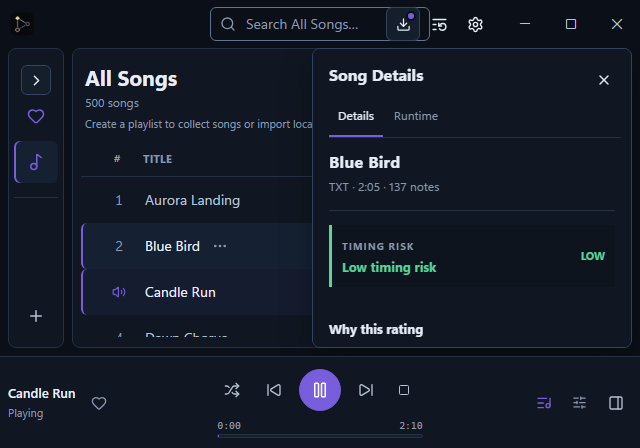
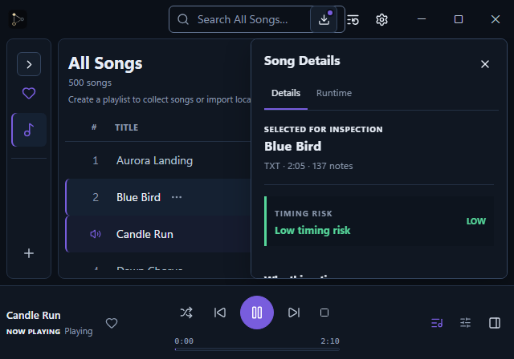
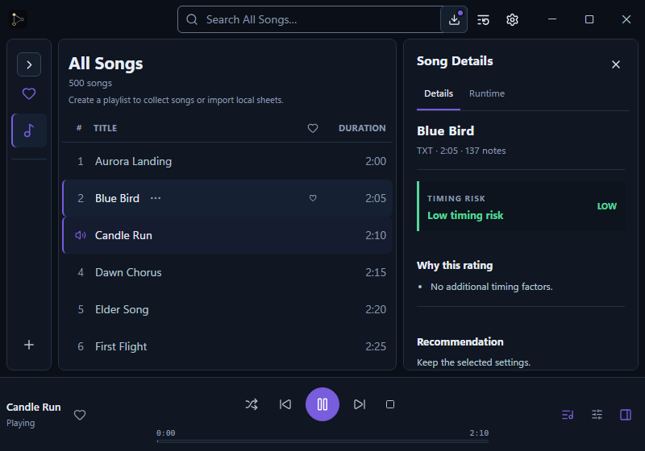
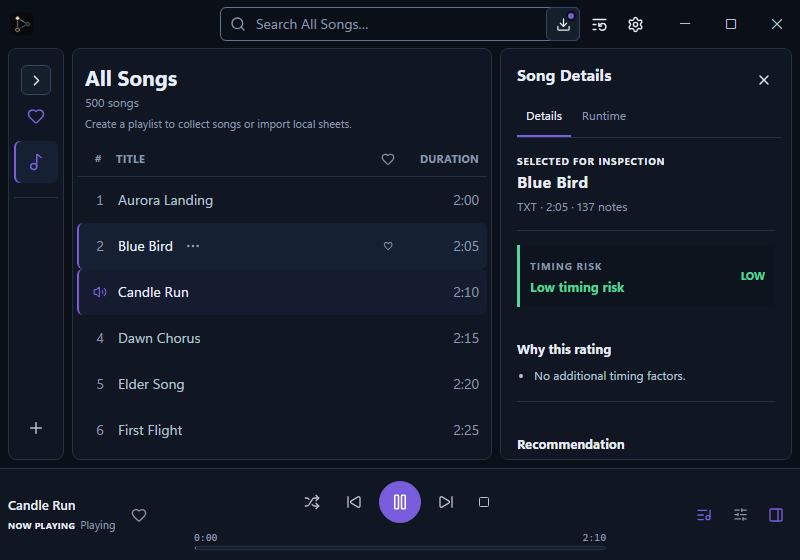
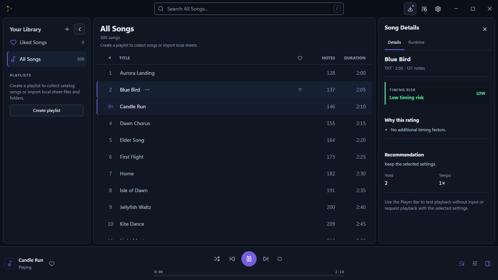
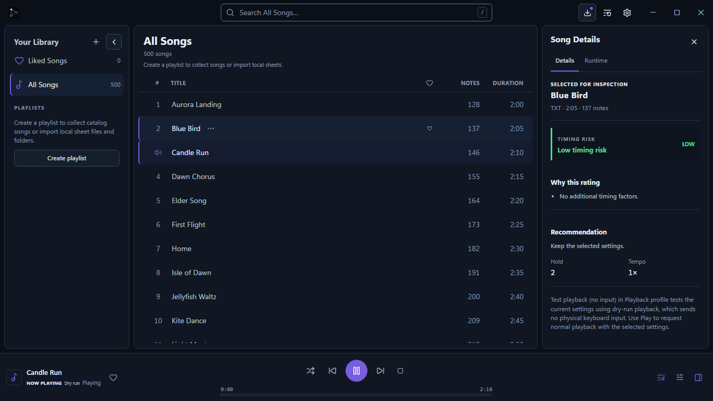

# Playback status and diagnostics evidence

These screenshots use the mock desktop bridge and show logical CSS viewport sizes. The baseline
captures were taken from commit `64f0ad13633afed909b256eb9aff62132308849d` before implementation;
the updated captures were taken from the completed frontend changes in this branch. The mock bridge
does not send physical keyboard input.

## Player identity and responsive workbench

In each workbench capture, Candle Run is the native playback identity and Blue Bird is selected for
inspection. The updated dock labels the active identity, while Song Details identifies the browsing
selection. At 640×448, the Inspector remains a temporary overlay and the Player Dock remains visible.

| Viewport | Before | After |
| --- | --- | --- |
| 640×448 |  |  |
| 800×560 |  |  |
| 1366×768 |  |  |

## No-input playback action

The existing `Test playback (no input)` action is shown before and after. The updated profile popover
explains that it performs a dry check without sending physical keyboard input. The details note also
points users to this action.

- Before: [Playback profile at 1366×768](before-no-input-profile-1366x768.png)
- After: [Playback profile at 1366×768](after-no-input-profile-1366x768.png)

## Runtime hierarchy

The baseline shows physical sender metrics and sender health. Updated captures show Playback status,
Now Playing identity, dry-run mode and the truthful “Not measured” sender state. All metric groups
remain available when scrolling the Runtime panel.

- Before: [Runtime diagnostics at 1366×768](before-runtime-1366x768.png)
- After: [Runtime diagnostics at 640×448](after-runtime-640x448.png),
  [800×560](after-runtime-800x560.png), and [1366×768](after-runtime-1366x768.png)
