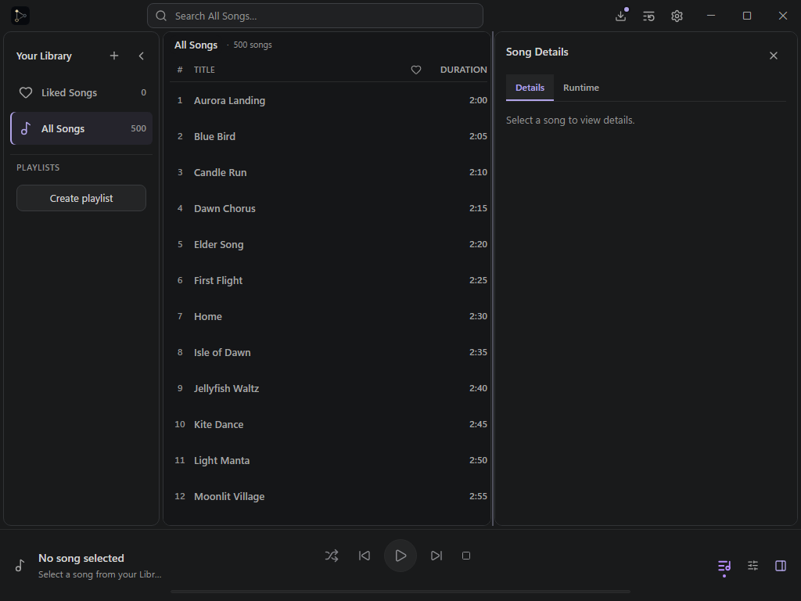

# Inspector resize correctness evidence

Scope: [#553](https://github.com/pumni/Sky-Auto-Player/issues/553), under
[#552](https://github.com/pumni/Sky-Auto-Player/issues/552). Baseline:
`e310b911e3ae188ffc779c1eba6369ffa765c621`. Only the shared implementation branch
`codex/ui-unification-workbench-performance-20261027` is used.

## Independent geometry oracle

At Graphite viewport 1024, the expanded budget is 8 px outer padding + 8 px
separators + at least 200 px navigator + at least 420 px track browser. Inspector
therefore cannot exceed **388 px**. Tests assert literal pane bounds read from
`getBoundingClientRect()`, without importing the production geometry solver.

| Requested Inspector | Baseline navigator / tracks / Inspector | Changed navigator / tracks / Inspector |
| ------------------- | --------------------------------------- | -------------------------------------- |
| 388                 | 200 / 420 / 388                         | 200 / 420 / 388                        |
| 389                 | 48 / 571 / 389                          | 200 / 420 / 388 (request clamped)      |
| 388                 | 200 / 420 / 388                         | 200 / 420 / 388                        |

The baseline browser run reproduced the 389 row as an expected failing regression
assertion (runner exit 1). Its source input restored the baseline separator and
layout hook with `git show e310b911:<path>` while retaining the new test and the
Workbench's optional drag callback wiring; both files were restored afterward.
The baseline 388 rows also follow directly from that unchanged geometry budget.
The changed run passed the complete sequence, one final storage write, reload,
keyboard resize/reset, explicit collapsed rail (48 / 520 / 440), and Tab navigation.

Additional literal oracles cover 1366 (300 / 610 / 440), 960 during drag
(200 / 420 / 324), and a viewport rebase to 900 during drag (200 / 420 / 264).
At session end, existing v5 normalization still enforces saved Inspector width

> =280; normal responsive fallback resumes after the pointer session. Temporary
> window shrink never rewrites saved navigator preference/expanded width.

## Update-count proxy

`ResizableSeparator.test.tsx` contains a deterministic jsdom/rAF probe: 100 pointer
moves before one frame, then 100 further moves against the maximum, each followed
by a frame, then pointerup. This counts actual `onChange` calls, not React renders,
Windows FPS, input latency, or WebView2 performance.

| Input             | Baseline changes | Changed changes | Final commits | Final width |
| ----------------- | ---------------- | --------------- | ------------- | ----------- |
| 200 pointer moves | 200              | 1               | 1 in both     | 388 in both |

Exact probe command (desktop directory):
`bun run test src/components/workbench/ResizableSeparator.test.tsx -t 'records a deterministic drag update proxy'`.
Baseline source input was the baseline separator plus the new test; runner exit 1
was expected (200 calls versus the new assertion of 1); eight unrelated tests
were filtered out. The PowerShell restoration wrapper itself exited 0. The changed
probe passes as part of the focused workbench tests.

## Contract coverage

- `ResizableSeparator.test.tsx`: rAF burst/last value, repeated clamped values,
  pointerup/cancel/lostcapture races and one commit, viewport rebasing, unmount
  cleanup including a deliberately invoked stale callback, pointer identity and
  capture, both directions, 8/32 px keys, Home/End/Enter, clamped doubleclick,
  disabled controls and ARIA/tab index.
- `useWorkbenchLayout.test.tsx`: independent 1024/1100/960 budgets, explicit toggle
  during a session, viewport rebase, lock disposal when docked separator unmounts,
  v5 roundtrip, saved expanded preference through temporary shrink, no-op queued
  updates and final persistence despite no state change.
- Existing `Workbench.test.tsx` retains v1-v5 migration and responsive tests.
- `workbench-resize.spec.ts`: actual pane bounds, capture, keyboard, focus return,
  storage write count/roundtrip, viewport changes, and closing during capture
  without a stale width commit. Existing browser assertions remain intact.

## Environment and limits

Measured on 2026-10-27, Windows 11 Home `10.0.26300` (build 26300), installed
WebView2 Runtime `157.0.4341.16`, registry `AppliedDPI=120` (125%). Browser tests
use Playwright Chromium/mock bridge and CSS logical pixels; they do not launch
the native application or validate WebView2/Snap behavior. No native FPS/heap or
manual native drag baseline was measured. Those measurements remain outstanding
for native acceptance; they are not a correctness-wave blocker per #553.

No dependencies, lockfiles, CSS geometry, palette migration, native input,
updater/release, CI/workflow, preference key/schema, or meaningful existing test
assertions were changed. No width transition or drag debounce was introduced.

Validation outcomes and the tested/pushed source identity are recorded in the
cumulative Draft PR handoff. Packaging/release/timing acceptance were not run:
this wave changes frontend resize behavior only.
