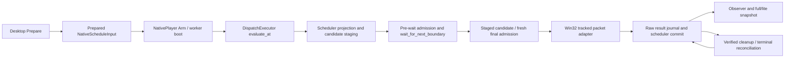

# Issue #666 Pre-Merge Rust Core Audit and Cleanup

## Scope and revision identity

This is a source audit and bounded cleanup of the existing Issue #666 PR. It is not M5, merge approval, or native gameplay qualification.

| Revision | SHA | Tree / parent |
|---|---|---|
| Reviewed integration baseline | `3a34e423c38655bd2ebda78cf277b21150a11b4f` | tree `79fa56d460018a76fb1d87a700f0ffa7ef6a8501`; parent `7446f6d37698d59aff5388c290e7a081bbd187f4` |
| PR base (`main` at review) | `96e35b6c7b9946289e2bd6b02a658a83811e80ec` | pinned comparison point |
| Audited source candidate | `a5ca51f1ec9dd30c635d4b7399fb826538bebbe2` | tree `c5e375e366182ba58262923805c7c7eff3c0dc1c`; parent `f0392a8189c1efac768f8425cdf5d1fbfbc0beeb` |

The final handoff records the evidence-only commit and final remote SHA separately. All Rust and desktop checks below were run against the audited source candidate; subsequent changes are limited to this evidence document.

## Production execution path

The desktop Prepare entry point compiles a `PreparedDispatchSchedule` before Play/Arm. Arm passes `NativeScheduleInput::Prepared` to `NativePlayer::arm`; worker boot consumes the plan using `DispatchExecutor::from_prepared_schedule` and does not rematerialize a schedule-sized arena on the prepared path. The worker takes a fresh QPC for each outer evaluation, stages through `evaluate_scheduler_action_for_staging` and `stage_scheduler_action_preserving_due_up`, admits before waiting, waits through `wait_for_next_boundary`, then calls `dispatch_staged_candidate`. The final admission performs current owner/focus/control checks before the tracked Win32 adapter crosses the physical `SendInput` boundary. The journal is committed only after raw sender evidence is reconciled. Safety cleanup and observer/snapshot publication remain separate consumers of the resulting state.

## Size and complexity comparison

The Rust line census covers `sky_dispatch_core`, `sky_dispatch_win32`, and `sky_player`. File classes are based on tracked Rust paths: production source files, behavior test files (`tests/` and `*_tests.rs`), and test-support/benchmark files. Inline `#[cfg(test)]` sections remain attributed to their containing source file.

| Three Rust crates | `main` at PR base | Audited candidate | Change |
|---|---:|---:|---:|
| Rust files | 148 | 159 | +11 |
| Production-source lines | 44,198 | 47,487 | +3,289 |
| Behavior-test lines | 12,488 | 18,823 | +6,335 |
| Test-support / benchmark lines | 2,546 | 3,360 | +814 |
| Total lines in these Rust files | 59,232 | 69,670 | +10,438 |

Across the full PR base-to-candidate diff, 78 files changed: `+16,060/-1,360` lines. Path-classified deltas are production Rust `+5,538/-965`, behavior-test files `+7,018/-345`, test-support/benchmark `+1,011/-26`, and docs/other `+2,493/-24`. This is the full M1–M4 PR delta, not work introduced by this correction.

The correction from the reviewed baseline is 14 files and `+1,503/-742` lines with rename detection. Content-classified, it is production logic `+22/-25`, test code and test-module declarations `+1,399/-717`, and test support `+82/-0`. The production change is the shared checked Down-cursor transition described below. No playback scheduler, final admission, sender, owner-proof, cleanup, timing-default, DTO, or schema behavior changed in this correction.

The only production implementation body consolidated by this checkpoint is the duplicated current-chord identity check, checked cancelled-counter arithmetic, and cursor increment in `consume_attempted_down_after_verified_cleanup` and `consume_attempted_down_after_proven_raw_zero`. Their distinct active-mask and verified-cleanup-barrier guards remain at the two callers. The shared private helper adds context-specific diagnostics and does not create completion evidence or cleanup state. The direct executor diff is `+22/-25` lines. The `dispatch_loop.rs` diff is test-only module wiring (`+22/-24`): it removes root-level test `include!` statements and the `m2_tests` wrapper, replacing them with named path modules. The transport test's retry-loop helper `candidate_after_scheduler_waits_at` was removed after its sole use became a controlled-QPC projection; `candidate_at_synthetic_qpc` rejects an unexpected Wait instead of waiting and backdating a later projection. No behavior test was deleted.

## Caller and responsibility census

| Area | Real caller / status | Classification and decision |
|---|---|---|
| `PreparedDispatchSchedule::prepare_with_cancellation` | Desktop Prepare and worker raw-schedule admission; prepared Arm consumes it through `from_prepared_schedule` | Production path. Retain Prepare-time arena construction and no Arm-time rebuild. |
| `DispatchExecutor::new_with_cancellation` | `timing_model::dispatch_schedule::analyze_dispatch_schedule_cancellable` | Production advisory caller; not dead. Keep its caller-supplied QPC conversion and independent advisory semantics. |
| Prepared and legacy arena construction | Both count intents, reserve flat chord/intent vectors, and materialize metadata | Duplicated responsibility, but not consolidated here. Prepared construction additionally owns ceiling QPC conversion, feasibility admission, retained-capacity input, and its cancellation checkpoints. The legacy advisory owns a supplied converter and separate error/admission mapping. A shared builder would be a semantic refactor requiring its own short/large/boundary equivalence oracle; the existing `prepared_plan_starts_fresh_and_matches_raw_executor_decisions`, conversion, cancellation, capacity, and scale tests remain the independent evidence. |
| CPU sampling in worker boot | Early pair initializes startup/observer CPU timing; the later pair is captured after `compute_playback_epoch` and rebases the playback-session baseline | Lifecycle/timing provenance, not a duplicate sample to delete. Reordering would change startup versus playback-epoch attribution. No sampling order changed. |
| Attempted Down after verified cleanup | Requires all active slots cleaned and a verified cleanup barrier | Guard remains specific to verified cleanup. |
| Attempted Down after proven raw zero | Requires a proven Down-only raw-zero result and no overlap with active slots; creates no cleanup barrier or completion timestamp | Guard remains specific to raw-zero continuation. Both paths now call a private checked cursor transition for current chord identity, checked cancellation counter, and cursor advance. It does not manufacture sender completion evidence or release another active key. Regression: `proven_raw_zero_uses_checked_cursor_transition_without_cleanup_or_active_a_release`. |
| `dispatch_loop_scheduler.rs` production include | `dispatch_loop.rs` production worker shares private scheduler/staging helpers and state | Retained: it is a production module include, not test text inclusion. Splitting ownership would be broader than this checkpoint. |
| `session_snapshot.rs` production include | `session.rs` full/lite snapshot projection | Retained as shared private snapshot implementation. Snapshot projection/schema is unchanged here. |
| Dispatch-loop tests | Formerly textually included in the root test module, including the `m2_tests` parent | Replaced by normal `#[path]` behavior modules and explicit fixtures/imports. No milestone parent or test `include!` remains. A repository search finds only the production scheduler and session-snapshot `include!` under the player source tree. |
| `WorkerRuntime.previous_sendinput_completion_qpc` / `previous_sender_completion_known` | No live `WorkerRuntime` fields remain | Write-only runtime storage was removed in prior accepted work. Same-named observation and telemetry values remain because metrics/observer consumers read them and preserve attribution. |
| `STARTUP_READINESS_RESERVE_US` | Read by the startup-readiness contract in `engine/config.rs` | Live policy constant; retained. |
| `poll_window_identity_authority() -> bool` | Public compatibility wrapper; desktop supervisor uses the typed result API | Public compatibility surface; retained. |
| Public Win32 `*_with_start` wrappers | Exported packet sender API and existing callers | Compatibility API; retained pending contract review. Internal search alone is not grounds for deletion. |
| `session.rs` / `worker.rs` production glob imports | Existing allowlisted imports; no new glob import added | Retained for the separately reviewed ownership cleanup. Test behavior modules use explicit imports where practical. |

## Fresh-QPC late retry regression

The old B-only preflight-cache regression intentionally evaluates at `epoch + 30 ms`; it proves only that a transient Busy does not clear a valid preflight stamp. It is not used as evidence for the worker packet shape after a stall past authored Up(A) at 80 ms.

`dispatch_loop_late_retry_tests.rs` adds independent production-harness cases. A Down(A) is committed first and its release proof is captured. A barrier holds the final owner-authority mutex while B's due candidate reaches the real final permit. The attempt returns `PermitBusy`; no sender call occurs, B's chord cursor remains pending, A's obligation/masks and owner proof remain unchanged, and the preflight probe count stays at one. After releasing the barrier, the test waits until the authored Up(A) time is actually due, obtains a fresh current QPC, verifies it is also beyond A's confirmed completion plus H, then calls the worker outer evaluation/staging path with that fresh QPC. It does not reuse the initial `epoch + 30 ms` projection.

| Retry shape | Sender/journal result | Scheduler and ownership assertions |
|---|---|---|
| Stable owner, final permit Busy, then late mixed retry | A Down: one attempt, raw inserted 1. Retry Up(A)+Down(B): one packet attempt, raw inserted 2. | One fresh scheduler evaluation stages both bits; A proof is the original proof; cursor advances only at successful commit; final active/release mask is B (`0b10`), possible/in-flight masks are zero. No repeated preflight. |
| Modifier blocks B during late mixed retry | A Down: one attempt; mixed fallback issues only Up(A): one attempt; later B Down: one attempt. | A Up commits at its authored due time; B cursor remains pending through fallback and then advances once; no duplicate Down and no repeated preflight. Release mask is zero after A Up and `0b10` after B Down. |
| HWND A→B or same-HWND generation ABA before mixed send | Only A's original Down call exists; mixed retry produces no syscall. | Final admission returns terminal `Exit` with the owner-origin mismatch diagnostic; A remains active with its release obligation and original proof; B's Down is not consumed and the old preflight stamp is not authorization for the new generation. |

The explicit H/G arithmetic assertions use supplied QPC ticks for floor−1, exact floor, and floor+1. `real_waiter_smoke_wakes_for_a_future_qpc_deadline` remains a separate actual waiter smoke. The H/G trace also exercises the production wait-to-send path; its boundary assertions are computed from captured QPC evidence rather than elapsed setup time. No test uses `sleep` to manufacture the race.

## Milestone test-module cleanup

| Old file | New behavior name |
|---|---|
| `dispatch_loop_m2_tests.rs` | `dispatch_loop_safety_tests.rs` |
| `dispatch_loop_m2_review_tests.rs` | `dispatch_loop_transport_outcome_tests.rs` |
| `dispatch_loop_m3_up_owner_tests.rs` | `dispatch_loop_owner_proof_tests.rs` |
| `dispatch_loop_m4_zero_tests.rs` | `dispatch_loop_raw_zero_tests.rs` |

The root module now declares `deadline_trace`, `failure`, `late_retry`, `observer`, `owner_proof`, `preflight_busy`, `raw_zero`, `replan_timing`, `safety`, `support`, and `transport_outcome` via `#[path]`. Tests no longer inherit a shared `include!` namespace; support is isolated in `dispatch_loop_test_support.rs`. The three modules called out by review (`transport_outcome`, `owner_proof`, and `raw_zero`) have explicit imports rather than `use super::*`. Current Rust/scripts contain no milestone-path caller. The one old path occurrence in `docs/evidence/issue-666-m3.md` documents a historical zero-test filter invocation and remains pinned to that earlier evidence.

The offline benchmark file, runner `scripts/run_issue666_m4_guard_ab_offline.ps1`, environment names, output markers, and test function name were not renamed. Discovery check found exactly one ignored `offline_waiter_guard_ab_benchmark`; it was not run. It remains labeled waiter-only and does not call `SendInput`.

## Production boundary and policy audit

No new dead production wrapper was deleted. The `DispatchExecutor` constructor split, exported bool owner-poll wrapper, Win32 start-time wrappers, and two production `include!` boundaries all have live callers or compatibility contracts. `target.rs`, `executor.rs`, `worker.rs`, and `dispatch_loop.rs` remain large modules, but line count alone did not justify an architectural move inside this bounded audit.

The 67 architecture advisories on the candidate are not evidence of 67 new regressions. Static check at the pinned PR base `main` reported 61; reviewed integration baseline and candidate both report 67. Thus this correction adds no advisory over the reviewed baseline. The six path-count additions relative to `main` are the raw-zero and safety behavior test files (renamed from milestone files), `engine/target.rs`, `executor/absolute_tests.rs`, `worker/admission.rs`, and `engine/tests/startup_admission.rs`. They reflect M1–M4 coverage/source growth, not the current P3 cleanup. The current static check completes with PASS and 67 warning(s); existing allowlisted production glob and Win32 unsafe-boundary advisories remain unchanged.

The desktop event-delivery failure policy was audited and deliberately left for an owner decision:

| Failure class | Current meaning / handling |
|---|---|
| Presentation-only: playback event queue closed/full/disconnected, snapshot event emission failure, or UI delivery failure | Current desktop code latches `event_delivery_failure`; cleanup policy can call `panic_release()` and `quit()`, and supervisor progress also considers delivery health. These failures do not by themselves prove that owner identity, lease, or worker session is invalid. |
| Playback/safety health: current-owner identity invalid, lease expiry, terminal worker outcome, power/suspend transition, accepted Stop/Skip, or cleanup verification failure | These require the existing owner/lease/session control path and safety cleanup. Watchdog, lease, terminal cleanup, and Stop/Skip protections must remain active. |

Decoupling presentation from playback requires an owner decision on whether delivery failure should terminate playback, degrade UI reporting, or stop only after a separate health failure. Any future change must preserve independent supervisor polling/watchdog, owner invalidation, lease expiry, power handling, Stop/Skip, and verified release cleanup. This checkpoint does not change lifecycle policy.

## Verification ledger

Platform/toolchain: Windows x64 MSVC target, Rust/Cargo 1.99.1.

| Command / evidence | Result on source candidate `a5ca51f1ec9dd30c635d4b7399fb826538bebbe2` |
|---|---|
| `git diff --check` | exit 0 |
| `cargo fmt --manifest-path rust/Cargo.toml --all -- --check` | exit 0 |
| `cargo fmt --manifest-path apps/desktop/src-tauri/Cargo.toml --all -- --check` | exit 0 |
| `cargo clippy --locked --manifest-path rust/Cargo.toml -p sky_player --lib --no-default-features -- -D warnings` | exit 0; no warnings |
| `cargo clippy --locked --manifest-path rust/Cargo.toml -p sky_dispatch_core -p sky_dispatch_win32 -p sky_player --all-targets --all-features -- -D warnings` | exit 0; no warnings |
| `cargo check --locked --manifest-path rust/Cargo.toml -p sky_player --lib --no-default-features` | exit 0; compiler output contained zero warnings |
| `cargo test --locked --manifest-path rust/Cargo.toml -p sky_dispatch_core --features test-support` | exit 0; 85 passed (81 unit, 1 property integration, 1 golden, 2 properties), 0 failed/ignored |
| `cargo test --locked --manifest-path rust/Cargo.toml -p sky_dispatch_win32 --features test-support` | exit 0; 278 passed, 1 intentionally ignored spawned-process helper, 0 failed |
| `cargo test --locked --manifest-path rust/Cargo.toml -p sky_player --features test-support` | exit 0; 321 passed, 1 intentionally ignored benchmark, 0 failed; doc tests 0 |
| `cargo test --locked --manifest-path rust/Cargo.toml -p sky_player --features test-support --test rt_dispatch_no_alloc` | exit 0; 4 passed, 0 failed |
| `cargo xtask check desktop-native` | exit 0; no Rust warning lines in the no-default, default, all-feature, or Tauri-test command output |
| `cargo xtask check all` | exit 0; static/security/toolchain contracts, workspace Clippy, workspace all-feature tests, Bun checks/E2E, and desktop shell checks passed sequentially; static advisories 67 |
| `cargo xtask check static` after adding this evidence | exit 0; documentation integrity PASS, architecture checks PASS (67 warning(s)), security checks PASS |
| Workspace ignored-test discovery: `cargo test --locked --manifest-path rust/Cargo.toml --workspace --all-features -- --ignored --list` | exit 0; 12 ignored tests discovered, none run (list below) |
| Benchmark discovery: `cargo test --locked --manifest-path rust/Cargo.toml -p sky_player --features test-support --lib offline_waiter_guard_ab_benchmark -- --ignored --list` | exit 0; exactly 1 ignored waiter-only benchmark found; not run |

Focused source-candidate regressions:

| Focus | Result |
|---|---|
| `engine::worker::dispatch_loop::tests::` | 65 passed, 0 failed/ignored |
| `late_retry::` | 3 passed, 0 failed |
| `preflight_busy::` | 6 passed, 0 failed |
| Exact H/G trace `scheduler_h_floor_and_g_floor_trace_wait_projection_and_single_sender_commit` | 1 passed |
| Separate real waiter smoke `real_waiter_smoke_wakes_for_a_future_qpc_deadline` | 1 passed |
| Transport anomaly retention test | 5 consecutive runs; each 1 passed, 0 failed |

Two intermediate verification issues were explicitly resolved. First, the initial post-cleanup rewrite compared a real resume barrier against a synthetic future cleanup-completion timestamp and failed; the cleanup emitter was corrected to sample the real QPC domain while authored scheduler projections and packet sender evidence remain controlled, after which the test passed five consecutive runs. Second, the first aggregate `cargo xtask check all` on pre-correction source `f0392a8189c1efac768f8425cdf5d1fbfbc0beeb` exited 1 because the 40-pair anomaly test used real 50 ms onset spacing and could cross its next onset during a loaded run. The test now evaluates at explicit scheduler QPC boundaries without real-time waits, and `cargo xtask check all` passed on the source candidate. An early focused H/G command with an incomplete `--exact` path selected 0 tests; it was not counted, and the fully qualified exact command then selected and passed 1 test.

The ignored tests found in the all-feature discovery pass were:

- `sky_app_core`: `catalog::perf_tests::opt_in_catalog_performance_measurement`; `catalog::perf_tests::opt_in_package_b_catalog_query_benchmark`.
- `sky_desktop_shell`: `native_runtime::catalog_reconcile::package_b_benchmark_tests::opt_in_package_b_catalog_reconciliation_benchmark`; `native_runtime::tests::catalog_package_b::opt_in_package_b_native_viewport_benchmark`; `native_runtime::tests::catalog_viewport_benchmark::opt_in_package_b_production_shape_viewport_benchmark`; `native_runtime::tests::catalog_viewport_benchmark::opt_in_package_b_viewport_projection_benchmark`.
- `sky_dispatch_win32`: `focus::tests::retained_process_child_for_identity_test`.
- `sky_player`: `engine::worker::timing::guard_ab_benchmark::offline_waiter_guard_ab_benchmark`.
- `xtask`: `release_signing::hosted_proof::hosted_disposable_tauri_private_key_roundtrip_through_adapter`; `release_v4::tests::public_v4_2_0_asset_pair_downloads_through_production_adapter`; `release_v4::tests::test_key_signature_is_verified_after_draft_readback_before_patch`; `updater_fixture::tests::tauri_signer_pair_is_verified_by_rust_and_rejects_malformed_or_wrong_pair`.

The test output also proves schema-25 serialized key-set fixtures remain pinned; this correction changes no public DTO, telemetry field, FPS/tempo/H/G/spin default, or authored timing policy. Zero-allocation production worker regressions pass 4/4. Mock sender insertion evidence is not Windows insertion evidence, and neither qualifies Sky gameplay note reception. No real `SendInput`, interactive focus, ReceiveOnly, gameplay, or native suspend/resume qualification was run.

## Remaining decisions

- Decide separately whether to consolidate prepared and legacy executor arena construction; retain independent conversion/admission contracts and add an independent boundary/scale oracle before doing so.
- Decide separately whether desktop presentation-delivery failure should terminate playback; preserve watchdog, lease, owner poll, Stop/Skip, power, and cleanup safety whichever policy is chosen.
- Review API compatibility before removing `poll_window_identity_authority() -> bool` or public Win32 `*_with_start` wrappers.
- Consider module ownership cleanup for large dispatch/target/executor files only as a separately reviewable change with caller and race-boundary proof.

Hosted CI status is recorded against the pushed final handoff SHA in the accompanying checkpoint; local PASS does not substitute for exact-HEAD hosted CI.
